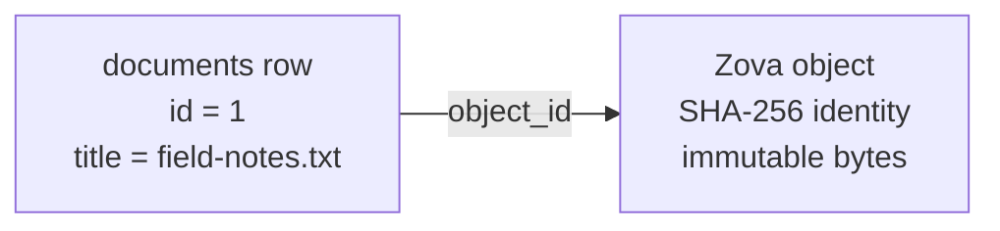

import Tabs from '@theme/Tabs';
import TabItem from '@theme/TabItem';

# Tutorial part 1: Store documents

This tutorial builds a small local document library in five parts. Each part is one short program that opens the same `library.zova` file and adds one capability:

| Part | Program | What you add |
|---|---|---|
| **1. Store documents** | `store` | SQL rows for metadata and content-addressed objects for file bytes |
| [2. Search by meaning](../tutorial/search.md) | `search` | one embedding per document and nearest-neighbor search, in code and in SQL |
| [3. Relate documents](../tutorial/relate.md) | `relate` | a graph of topics and citations, traversed in code and joined in SQL |
| [4. Keep app state and react to changes](../tutorial/state.md) | `state` | a reading position in key-value storage and change events that follow transactions |
| [5. Back up and reclaim space](../tutorial/maintain.md) | `maintain` | a verified backup and page reclamation after deleting a large object |

Every step is shown in JavaScript, Python, Rust, and Go. Pick a language tab once and the choice follows you across pages. The programs on these pages were run against the Zova 1.4.0 packages, and each **Expected output** block is what they printed. The prose names calls in snake_case, as Python and Rust spell them; JavaScript and Go use the same names in camelCase and PascalCase, such as `putObject` and `PutObject` for `put_object`.

Run the parts in order. Each program assumes the previous ones already ran against `library.zova`. To start over, delete `library.zova` and run part 1 again.

## What you will build in this part

At the end of this part, `library.zova` contains:

- a `documents` table owned by your application;
- three document rows with a title and media type; and
- three content-addressed objects holding the document bytes, each referenced from its row.



This is the basic Zova pattern: SQL describes the application entity, and specialized storage holds the data shape it is designed for.

## Set up a project

Create a project directory and add the Zova 1.4.0 package. See [Installation](./installation.md) for platform requirements.

<Tabs groupId="programming-languages" defaultValue="javascript">
  <TabItem value="javascript" label="JavaScript">

```sh
mkdir zova-library && cd zova-library
npm init -y
npm install zova-js@1.4.0
```

Each part is an ES module file such as `store.mjs`, run with Node.js 22 or newer.

  </TabItem>
  <TabItem value="python" label="Python">

```sh
uv init --bare --python 3.13 zova-library && cd zova-library
uv add zova==1.4.0
```

Each part is a script such as `store.py`. Zova's wheels require Python 3.13 or newer.

  </TabItem>
  <TabItem value="rust" label="Rust">

```sh
cargo new zova-library && cd zova-library
cargo add zova@1.4.0
mkdir src/bin
```

Each part is a separate binary such as `src/bin/store.rs`.

  </TabItem>
  <TabItem value="go" label="Go">

```sh
mkdir zova-library && cd zova-library
go mod init example.com/library
go get github.com/ata-sesli/zova/bindings/go@v1.4.0
export CGO_CFLAGS="-I/absolute/path/to/zova-c-abi/include"
export CGO_LDFLAGS="-L/absolute/path/to/zova-c-abi/lib -lzova_c"
```

The Go package links the C ABI archive from the same release; [Installation](./installation.md#go) covers the download and Windows settings. Each part is a package directory such as `store/main.go`.

  </TabItem>
</Tabs>

## Step 1: Create the database

<Tabs groupId="programming-languages" defaultValue="javascript">
  <TabItem value="javascript" label="JavaScript">

```js
const db = Database.create("library.zova");
try {
  // ...
} finally {
  db.close();
}
```

  </TabItem>
  <TabItem value="python" label="Python">

```python
with zova.Database.create("library.zova") as db:
    ...  # the rest of this part runs inside this block
```

  </TabItem>
  <TabItem value="rust" label="Rust">

```rust
let mut db = Database::create("library.zova")?;
```

  </TabItem>
  <TabItem value="go" label="Go">

```go
db, err := zova.Create("library.zova")
must(err)
defer db.Close()
```

  </TabItem>
</Tabs>

`create` makes a new `.zova` file. It initializes SQLite, Zova's format metadata, and the private schemas used by specialized storage. It refuses a path that already exists, so running this program twice fails with `ZOVA_DESTINATION_EXISTS`. Use `open` for an existing Zova file and the [SQLite migration workflow](../guides/sqlite-migration.md) for an existing SQLite database; a renamed `.sqlite` file is not equivalent.

The Go examples use a small `must` helper that stops the program on any error; the complete program at the end of each page defines it.

## Step 2: Create the application schema

<Tabs groupId="programming-languages" defaultValue="javascript">
  <TabItem value="javascript" label="JavaScript">

```js
db.exec(`create table documents(
  id integer primary key,
  title text not null,
  media_type text not null,
  object_id blob not null,
  created_at text not null default current_timestamp
)`);
```

  </TabItem>
  <TabItem value="python" label="Python">

```python
db.exec(
    "create table documents("
    "id integer primary key, "
    "title text not null, "
    "media_type text not null, "
    "object_id blob not null, "
    "created_at text not null default current_timestamp)"
)
```

  </TabItem>
  <TabItem value="rust" label="Rust">

```rust
db.exec(
    "create table documents(\
       id integer primary key,\
       title text not null,\
       media_type text not null,\
       object_id blob not null,\
       created_at text not null default current_timestamp\
     )",
)?;
```

  </TabItem>
  <TabItem value="go" label="Go">

```go
must(db.Exec(`create table documents(
	id integer primary key,
	title text not null,
	media_type text not null,
	object_id blob not null,
	created_at text not null default current_timestamp
)`))
```

  </TabItem>
</Tabs>

The table belongs entirely to your application. Zova does not reinterpret the title, add indexes, or enforce a relationship between `object_id` and its private object tables. Ordinary SQLite tools can read your schema without understanding Zova features.

Use SQL constraints for application rules. If titles must be unique or a document belongs to a user, model that here exactly as you would in SQLite.

## Step 3: Store bytes and link them to rows

<Tabs groupId="programming-languages" defaultValue="javascript">
  <TabItem value="javascript" label="JavaScript">

```js
for (const [title, mediaType, body] of documents) {
  const objectId = db.putObject(encoder.encode(body));
  const insert = db.prepare(
    "insert into documents(title, media_type, object_id) values (?1, ?2, ?3)",
  );
  insert.bindText(1, title);
  insert.bindText(2, mediaType);
  insert.bindBlob(3, objectId);
  if (insert.step() !== Step.Done) throw new Error("insert did not finish");
  insert.close();
  console.log(`stored document ${db.lastInsertRowid()}: ${title}`);
}
```

  </TabItem>
  <TabItem value="python" label="Python">

```python
for title, media_type, body in DOCUMENTS:
    object_id = db.put_object(body)
    with db.prepare(
        "insert into documents(title, media_type, object_id) values (?1, ?2, ?3)"
    ) as insert:
        insert.bind_text(1, title)
        insert.bind_text(2, media_type)
        insert.bind_blob(3, bytes(object_id))
        assert insert.step() == zova.Step.DONE
    print(f"stored document {db.last_insert_rowid()}: {title}")
```

  </TabItem>
  <TabItem value="rust" label="Rust">

```rust
for (title, media_type, body) in DOCUMENTS {
    let object_id = db.put_object(body)?;
    let mut insert = db.prepare(
        "insert into documents(title, media_type, object_id) values (?1, ?2, ?3)",
    )?;
    insert.bind_text(1, title)?;
    insert.bind_text(2, media_type)?;
    insert.bind_blob(3, object_id.as_ref())?;
    assert_eq!(insert.step()?, Step::Done);
    drop(insert);
    println!("stored document {}: {title}", db.last_insert_rowid()?);
}
```

  </TabItem>
  <TabItem value="go" label="Go">

```go
for _, doc := range documents {
	objectID, err := db.PutObject([]byte(doc.body))
	must(err)
	insert, err := db.Prepare("insert into documents(title, media_type, object_id) values (?1, ?2, ?3)")
	must(err)
	must(insert.BindText(1, doc.title))
	must(insert.BindText(2, doc.mediaType))
	must(insert.BindBlob(3, objectID[:]))
	if step, err := insert.Step(); err != nil || step != zova.StepDone {
		log.Fatalf("insert did not finish: %v", err)
	}
	must(insert.Close())
	rowID, err := db.LastInsertRowID()
	must(err)
	fmt.Printf("stored document %d: %s\n", rowID, doc.title)
}
```

  </TabItem>
</Tabs>

`put_object` stores immutable bytes and returns their **object ID**: the SHA-256 hash of the complete contents. Putting identical bytes again returns the same ID. Internally, Zova splits object data into chunks and deduplicates them, but callers only work with the identity of the complete object.

The ID says what the bytes are, not what they mean. The filename, media type, and lifecycle stay in the SQL row, which stores the ID as a 32-byte blob.

Prepared statements keep values separate from SQL text and are the normal interface for user input. A step result of `Done` means the statement finished without producing a row. `last_insert_rowid` returns the row ID SQLite generated on this connection.

:::note[Lifecycle is yours]
Deleting the SQL row does not delete the object, and deleting the object does not rewrite the row. Decide whether objects can be shared, retained, or garbage-collected as part of your application model. Part 5 deletes an object and reclaims its space.
:::

## Step 4: Read documents back

<Tabs groupId="programming-languages" defaultValue="javascript">
  <TabItem value="javascript" label="JavaScript">

```js
const query = db.prepare("select title, object_id from documents order by id");
while (query.step() === Step.Row) {
  const title = query.columnText(0);
  const storedId = query.columnBlob(1);
  const body = db.getObject(storedId);
  console.log(`${title}: ${body.byteLength} bytes, object ${objectIdToHex(storedId).slice(0, 12)}…`);
}
query.close();
```

  </TabItem>
  <TabItem value="python" label="Python">

```python
with db.prepare("select title, object_id from documents order by id") as query:
    while query.step() == zova.Step.ROW:
        title = query.column_text(0)
        stored_id = zova.ObjectId(query.column_blob(1))
        body = db.get_object(stored_id)
        print(f"{title}: {len(body)} bytes, object {stored_id.hex()[:12]}…")
```

  </TabItem>
  <TabItem value="rust" label="Rust">

```rust
// A statement borrows the database, so collect rows before reading objects.
let mut rows = Vec::new();
let mut query = db.prepare("select title, object_id from documents order by id")?;
while query.step()? == Step::Row {
    let title = query.column_text(0)?.unwrap();
    let object_id = ObjectId::try_from(query.column_blob(1)?.unwrap().as_slice())?;
    rows.push((title, object_id));
}
drop(query);

for (title, object_id) in rows {
    let body = db.get_object(object_id)?;
    let hex: String = object_id.as_ref().iter().take(6).map(|b| format!("{b:02x}")).collect();
    println!("{title}: {} bytes, object {hex}…", body.len());
}
```

  </TabItem>
  <TabItem value="go" label="Go">

```go
query, err := db.Prepare("select title, object_id from documents order by id")
must(err)
defer query.Close()
for {
	step, err := query.Step()
	must(err)
	if step != zova.StepRow {
		break
	}
	title, _, err := query.ColumnText(0)
	must(err)
	blob, _, err := query.ColumnBlob(1)
	must(err)
	var objectID zova.ObjectID
	copy(objectID[:], blob)
	body, err := db.GetObject(objectID)
	must(err)
	fmt.Printf("%s: %d bytes, object %s…\n", title, len(body), hex.EncodeToString(objectID[:6]))
}
```

  </TabItem>
</Tabs>

The query returns metadata and a reference. The object API resolves that reference and verifies the content-addressed data before returning it.

In Rust, a prepared statement borrows the database, so the program collects rows first and reads objects after dropping the statement.

For a large object, read only the part you need with a range read or a seekable reader, and write incrementally with an object writer. The [Objects](../core/objects.md) chapter covers both, and [Serve objects with range requests](../guides/serve-object-ranges.md) shows them in an HTTP handler.

## Run it

<Tabs groupId="programming-languages" defaultValue="javascript">
  <TabItem value="javascript" label="JavaScript">

```sh
node store.mjs
```

  </TabItem>
  <TabItem value="python" label="Python">

```sh
uv run store.py
```

  </TabItem>
  <TabItem value="rust" label="Rust">

```sh
cargo run --bin store
```

  </TabItem>
  <TabItem value="go" label="Go">

```sh
go run ./store
```

  </TabItem>
</Tabs>

Expected output:

```text
stored document 1: field-notes.txt
stored document 2: storage-design.md
stored document 3: travel-log.txt
field-notes.txt: 37 bytes, object 3d873715b1cd…
storage-design.md: 43 bytes, object f37d336b4054…
travel-log.txt: 39 bytes, object 06de792714d2…
```

The object IDs are hashes of the bytes, so they are the same on every machine and in every language.

## The complete program

<Tabs groupId="programming-languages" defaultValue="javascript">
  <TabItem value="javascript" label="JavaScript">

```js title="store.mjs"
import { Database, Step, objectIdToHex } from "zova-js";

const documents = [
  ["field-notes.txt", "text/plain", "Notes from the storage design review."],
  ["storage-design.md", "text/markdown", "# Storage design\nMetadata stays relational."],
  ["travel-log.txt", "text/plain", "Day 1: trains, coffee, and a long walk."],
];
const encoder = new TextEncoder();

const db = Database.create("library.zova");
try {
  db.exec(`create table documents(
    id integer primary key,
    title text not null,
    media_type text not null,
    object_id blob not null,
    created_at text not null default current_timestamp
  )`);

  for (const [title, mediaType, body] of documents) {
    const objectId = db.putObject(encoder.encode(body));
    const insert = db.prepare(
      "insert into documents(title, media_type, object_id) values (?1, ?2, ?3)",
    );
    insert.bindText(1, title);
    insert.bindText(2, mediaType);
    insert.bindBlob(3, objectId);
    if (insert.step() !== Step.Done) throw new Error("insert did not finish");
    insert.close();
    console.log(`stored document ${db.lastInsertRowid()}: ${title}`);
  }

  const query = db.prepare("select title, object_id from documents order by id");
  while (query.step() === Step.Row) {
    const title = query.columnText(0);
    const storedId = query.columnBlob(1);
    const body = db.getObject(storedId);
    console.log(`${title}: ${body.byteLength} bytes, object ${objectIdToHex(storedId).slice(0, 12)}…`);
  }
  query.close();
} finally {
  db.close();
}
```

  </TabItem>
  <TabItem value="python" label="Python">

```python title="store.py"
import zova

DOCUMENTS = [
    ("field-notes.txt", "text/plain", b"Notes from the storage design review."),
    ("storage-design.md", "text/markdown", b"# Storage design\nMetadata stays relational."),
    ("travel-log.txt", "text/plain", b"Day 1: trains, coffee, and a long walk."),
]

with zova.Database.create("library.zova") as db:
    db.exec(
        "create table documents("
        "id integer primary key, "
        "title text not null, "
        "media_type text not null, "
        "object_id blob not null, "
        "created_at text not null default current_timestamp)"
    )

    for title, media_type, body in DOCUMENTS:
        object_id = db.put_object(body)
        with db.prepare(
            "insert into documents(title, media_type, object_id) values (?1, ?2, ?3)"
        ) as insert:
            insert.bind_text(1, title)
            insert.bind_text(2, media_type)
            insert.bind_blob(3, bytes(object_id))
            assert insert.step() == zova.Step.DONE
        print(f"stored document {db.last_insert_rowid()}: {title}")

    with db.prepare("select title, object_id from documents order by id") as query:
        while query.step() == zova.Step.ROW:
            title = query.column_text(0)
            stored_id = zova.ObjectId(query.column_blob(1))
            body = db.get_object(stored_id)
            print(f"{title}: {len(body)} bytes, object {stored_id.hex()[:12]}…")
```

  </TabItem>
  <TabItem value="rust" label="Rust">

```rust title="src/bin/store.rs"
use std::convert::TryFrom;
use zova::{Database, ObjectId, Step};

const DOCUMENTS: [(&str, &str, &[u8]); 3] = [
    ("field-notes.txt", "text/plain", b"Notes from the storage design review."),
    ("storage-design.md", "text/markdown", b"# Storage design\nMetadata stays relational."),
    ("travel-log.txt", "text/plain", b"Day 1: trains, coffee, and a long walk."),
];

fn main() -> Result<(), zova::Error> {
    let mut db = Database::create("library.zova")?;
    db.exec(
        "create table documents(\
           id integer primary key,\
           title text not null,\
           media_type text not null,\
           object_id blob not null,\
           created_at text not null default current_timestamp\
         )",
    )?;

    for (title, media_type, body) in DOCUMENTS {
        let object_id = db.put_object(body)?;
        let mut insert = db.prepare(
            "insert into documents(title, media_type, object_id) values (?1, ?2, ?3)",
        )?;
        insert.bind_text(1, title)?;
        insert.bind_text(2, media_type)?;
        insert.bind_blob(3, object_id.as_ref())?;
        assert_eq!(insert.step()?, Step::Done);
        drop(insert);
        println!("stored document {}: {title}", db.last_insert_rowid()?);
    }

    // A statement borrows the database, so collect rows before reading objects.
    let mut rows = Vec::new();
    let mut query = db.prepare("select title, object_id from documents order by id")?;
    while query.step()? == Step::Row {
        let title = query.column_text(0)?.unwrap();
        let object_id = ObjectId::try_from(query.column_blob(1)?.unwrap().as_slice())?;
        rows.push((title, object_id));
    }
    drop(query);

    for (title, object_id) in rows {
        let body = db.get_object(object_id)?;
        let hex: String = object_id.as_ref().iter().take(6).map(|b| format!("{b:02x}")).collect();
        println!("{title}: {} bytes, object {hex}…", body.len());
    }
    Ok(())
}
```

  </TabItem>
  <TabItem value="go" label="Go">

```go title="store/main.go"
package main

import (
	"encoding/hex"
	"fmt"
	"log"

	zova "github.com/ata-sesli/zova/bindings/go"
)

var documents = []struct{ title, mediaType, body string }{
	{"field-notes.txt", "text/plain", "Notes from the storage design review."},
	{"storage-design.md", "text/markdown", "# Storage design\nMetadata stays relational."},
	{"travel-log.txt", "text/plain", "Day 1: trains, coffee, and a long walk."},
}

func main() {
	db, err := zova.Create("library.zova")
	must(err)
	defer db.Close()

	must(db.Exec(`create table documents(
		id integer primary key,
		title text not null,
		media_type text not null,
		object_id blob not null,
		created_at text not null default current_timestamp
	)`))

	for _, doc := range documents {
		objectID, err := db.PutObject([]byte(doc.body))
		must(err)
		insert, err := db.Prepare("insert into documents(title, media_type, object_id) values (?1, ?2, ?3)")
		must(err)
		must(insert.BindText(1, doc.title))
		must(insert.BindText(2, doc.mediaType))
		must(insert.BindBlob(3, objectID[:]))
		if step, err := insert.Step(); err != nil || step != zova.StepDone {
			log.Fatalf("insert did not finish: %v", err)
		}
		must(insert.Close())
		rowID, err := db.LastInsertRowID()
		must(err)
		fmt.Printf("stored document %d: %s\n", rowID, doc.title)
	}

	query, err := db.Prepare("select title, object_id from documents order by id")
	must(err)
	defer query.Close()
	for {
		step, err := query.Step()
		must(err)
		if step != zova.StepRow {
			break
		}
		title, _, err := query.ColumnText(0)
		must(err)
		blob, _, err := query.ColumnBlob(1)
		must(err)
		var objectID zova.ObjectID
		copy(objectID[:], blob)
		body, err := db.GetObject(objectID)
		must(err)
		fmt.Printf("%s: %d bytes, object %s…\n", title, len(body), hex.EncodeToString(objectID[:6]))
	}
}

func must(err error) {
	if err != nil {
		log.Fatal(err)
	}
}
```

  </TabItem>
</Tabs>

## Inspect the file

The CLI reports what the program wrote without dumping object bytes or application rows:

```sh
zova info library.zova
zova tables library.zova
zova objects library.zova
zova check --deep library.zova
```

`zova objects` lists the three object IDs with their sizes. `zova check --deep` validates the SQLite structure and every specialized store, and ends with `status: ok`.

## What you learned

- A `.zova` file is a SQLite database plus Zova-owned private tables. Your schema stays yours.
- Objects are immutable bytes identified by their SHA-256 hash. Store the ID in your rows.
- Metadata stays relational. Objects complement SQL rows rather than replacing them.
- The link between a row and its object is application policy, not a foreign key Zova enforces.

**Next:** [Part 2: Search by meaning](../tutorial/search.md) gives each document an embedding and ranks them by similarity.
