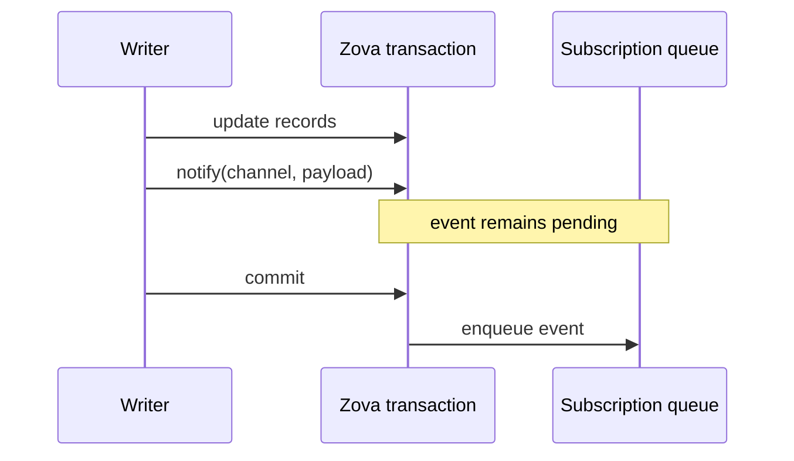

# App events

App events are explicit same-process notifications associated with one open database handle. They let one component announce that a committed storage workflow changed data another component should reload.

They are intentionally smaller than a message broker: no network, persistence, replay, or automatic change observation.

## Listen, write, then notify

```rust
let mut listener = db.listen("message:123:attachments")?;

db.begin_immediate()?;
db.exec(
    "insert into attachments(message_id, filename) \
     values (123, 'photo.jpg')",
)?;
db.notify("message:123:attachments", "changed")?;
db.commit()?;

if let Some(event) = listener.try_receive()? {
    assert_eq!(event.channel, "message:123:attachments");
    assert_eq!(event.payload, "changed");
}
```

The payload tells the listener what to reload; the database remains the source of truth. Prefer a small stable identifier or action word over copying an entire record into the event.

## Delivery follows transactions

Calling `notify` inside a Zova-managed transaction queues the event. Delivery occurs only after commit:



Rollback discards pending events. Rolling back to a savepoint discards events created inside that rolled-back scope; releasing a savepoint preserves them for the surrounding transaction.

This lets an application update SQL, objects, vectors, or graphs and publish one refresh signal only when the storage change is accepted.

KV batches follow the same rule. An atomic batch plus one notification in the caller transaction is a useful aggregate cache-invalidation pattern: listeners receive the signal only after every entry commits.

SQL `zova_notify(...)` participates when the surrounding transaction or savepoint was opened through Zova helpers. Raw SQL transaction scopes that Zova cannot track are rejected rather than assigned guessed delivery semantics.

## Events are explicit

Zova does not emit events automatically for SQL statements or specialized mutations. If graph changes should refresh a view, call `notify("graph:changed", "...")` as part of that workflow.

Explicit notification avoids hidden per-row traffic and lets the application choose the right semantic granularity. One document import may write hundreds of rows and vectors but need only one `document:indexed` event.

## Channel and queue limits

Channel names are ASCII, 1–128 bytes, using letters, digits, `_`, `.`, `:`, and `-`. Payloads are UTF-8 text up to 64 KiB.

Each subscription queue holds 1,024 notifications. On overflow, Zova drops the oldest event and reports the drop count with the next received event. A listener that observes drops should reload authoritative state rather than assuming it can reconstruct every intermediate change.

The API is polling-only through receive and drain operations. It does not create background worker threads or invoke callbacks.

JavaScript `AsyncDatabase` queues event operations FIFO and provides asynchronous receive polling. This is still polling over an in-memory queue, not durable or cross-process delivery.

## Design channels around invalidation

Useful channel patterns identify the scope that became stale:

```text
document:42:indexed
message:123:attachments
project:7:graph
search:catalog
```

Avoid a unique subscription per unbounded application entity when a coarser channel and payload can represent the same invalidation. Subscription count and polling strategy are application resource decisions.

## Know when not to use app events

Use another system when you need:

- communication between processes or machines;
- durable delivery after restart;
- replay or consumer offsets;
- an audit log;
- automatic observation of every mutation; or
- guaranteed processing by an offline consumer.

App events are best for coordinating components inside one process that already share a Zova handle and can reload state by ID.
