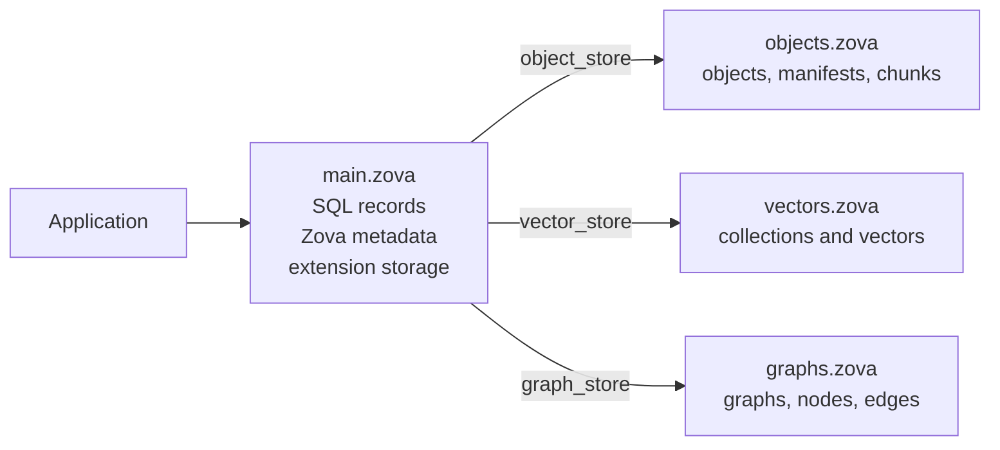

# Optional bound stores

A single `.zova` file is the default and simplest deployment. Optional bound stores let object bytes, vector rows, or graph topology live in separate local files while user SQL records remain in the main database.

Use this feature for an operational reason—different placement, growth, copying, or lifecycle—not because specialized data requires it. Every normal `.zova` file already supports objects, vectors, and graphs.

## The storage layout

A main database may bind at most one store of each specialized type:



When Zova opens `main.zova`, it validates and attaches the configured files to the same SQLite connection. Existing object, vector, and graph APIs then route transparently to the active store. Your SQL tables and extension-owned tables remain in the main file.

The paths are local bindings. Zova does not upload, synchronize, discover, or repair remote stores.

## Decide whether to split

Keep a single file when:

- the database is easy to copy and back up as one unit;
- specialized data shares the same retention lifecycle as records;
- deployment simplicity matters more than separate placement; or
- you do not yet have a measured storage problem.

Consider a bound store when:

- object bytes dominate file size and need a different local volume;
- vectors are rebuilt or replaced on a different schedule from records;
- graph topology needs a separate operational artifact; or
- a product intentionally packages one records file with replaceable specialized stores.

Bound stores add file-set consistency and SQLite `ATTACH` considerations. They should solve a concrete problem large enough to justify that complexity.

## Bind an empty store

Create the specialized store first, then bind it to a main database whose corresponding internal storage is empty:

```sh
zova object-store create objects.zova
zova object-store bind main.zova objects.zova

zova vector-store create vectors.zova
zova vector-store bind main.zova vectors.zova

zova graph-store create graphs.zova
zova graph-store bind main.zova graphs.zova
```

A first-time bind is rejected when the main file already contains that kind of private data. Attaching an empty object store over existing internal objects would make those objects appear to vanish, so Zova refuses the operation instead of hiding them.

After binding, inspect the resolved configuration:

```sh
zova object-store info main.zova
zova vector-store info main.zova
zova graph-store info main.zova
zova check --deep main.zova
```

## Split existing data

Use `split` when the main database already contains specialized rows that must move into a new store:

```sh
zova backup main.zova before-split.zova

zova split --objects main.zova objects.zova
zova split --vectors main.zova vectors.zova
zova split --graphs main.zova graphs.zova
```

Each destination must be a new `.zova` path. Zova does not overwrite an existing file.

A split is an explicit in-place migration:

1. Create the destination store.
2. Copy the selected Zova-owned rows into it.
3. Clear those rows from the main file.
4. Record and attach the binding.
5. Verify the resulting file set.

User SQL tables and rows stay in `main.zova`. After a successful split, rollback means restoring the pre-split backup or performing another deliberate migration; deleting the new store is not a rollback.

:::warning[Back up before splitting]
Split changes the source database and creates a multi-file layout. Make and verify a backup before starting, then keep it until the application has opened and validated the new layout.
:::

## What normal application code sees

Once the database opens successfully, storage placement is transparent:

- `put_object` writes to the bound object store;
- vector collection and vector operations use the bound vector store;
- graph, node, edge, neighbor, and walk operations use the bound graph store; and
- SQL records continue to use the main database.

This routing also applies to Zova's SQL-native vector and graph helpers because the stores are attached to the Zova-owned SQLite connection.

Store management itself remains explicit. In v0.26.1, create, bind, split, and unbind are available through the CLI and native Zig API, not the high-level JavaScript, Rust, Python, or Go APIs.

## Identity and consistency checks

Paths alone cannot prove that a collection of files belongs together. Zova records store identities, a bound-set ID, and per-store epochs. On open it rejects states such as:

- the configured file is missing;
- a file exists at the path but is the wrong kind of store;
- a different store was substituted;
- main and store markers disagree; or
- the files appear to come from different points in a split operation.

`zova doctor` and `zova check --deep` report these as bound-store diagnostics without mutating files.

Do not edit binding rows or identity markers directly. Their purpose is to turn silent misrouting into an explicit failure.

## Move a store safely

Moving a file does not trigger an automatic path search. After moving it, bind the main database to the new path:

```sh
mv objects.zova archive/objects.zova
zova object-store bind main.zova archive/objects.zova
zova check --deep main.zova
```

Equivalent commands exist for vector and graph stores. The replacement store is validated before binding metadata is updated. A marker mismatch is a consistency error, not a prompt for Zova to guess which file is correct.

## Unbind without deleting data

```sh
zova object-store unbind main.zova
zova vector-store unbind main.zova
zova graph-store unbind main.zova
```

Unbind removes attachment and binding metadata. It does not delete or inline the external store. Understand where subsequent specialized reads will route before using it; unbind is not a merge operation.

## Transactions and crash atomicity

Bound-store mutations participate through SQLite `ATTACH` and the same Zova transaction/savepoint stack where the operation supports it. Store management commands are rejected while the main database has an active transaction or savepoint.

SQLite's documented journal-mode rules determine whether a multi-file transaction is crash-atomic. Zova's IDs and epochs help detect and explain a split file set after failure, but they do not create a stronger commit protocol.

If a workflow depends on atomic changes across files, choose and test the journal configuration deliberately, including abrupt process and power-loss scenarios relevant to the deployment.

## Backup, compact, and restore

Zova's operational copy commands are bound-store-aware:

```sh
zova backup main.zova backup.zova
zova compact main.zova compact.zova
zova restore backup.zova restored.zova
```

They copy readable bound object, vector, and graph data into a **self-contained destination**. They do not reproduce the source's external-store layout. This makes the output portable as one file and gives restoration a simpler default.

If your product requires a multi-file package that preserves the original layout, build and verify that packaging workflow explicitly; v0.26.1 does not provide a bundle-backup format.

## Bound stores are not

- distributed storage;
- cloud or network mounts managed by Zova;
- replication or synchronization;
- automatic path repair;
- multiple named stores or routing rules; or
- a stronger transaction system than SQLite.

Run [diagnostics](../operations/diagnostics.md) after every bind, split, move, or restore, and document the complete file set in deployment and recovery procedures.
