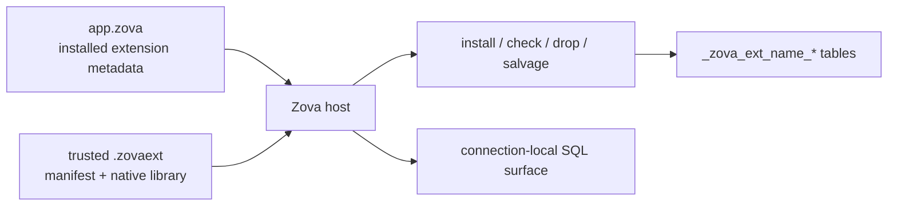

# Extensions

Extensions add trusted native behavior and private Zova-owned metadata. They can register SQL functions or virtual tables, manage namespaced storage, and participate in install, health-check, drop, and salvage workflows.

The central rule is simple: **a database can require extension code, but it can never cause that code to load by itself**.

## Database state is not executable code

An installed extension has two parts:

1. Metadata in the `.zova` file records the extension name, version, storage prefix, and manifest expectations.
2. The application or CLI process provides matching trusted code.



Opening a database with a required extension whose code is unavailable fails clearly. Zova does not ignore the requirement, search arbitrary library paths, or load executable bytes from the database.

## Extension sources in v0.24

The process can provide extensions in three ways:

- bundled extensions shipped with Zova, such as `trgm`;
- app-registered native Zig extensions; or
- explicitly supplied and trusted local `.zovaext` bundles.

The high-level Rust, Python, and Go bindings can manage extensions already present in the process registry. They do not yet provide stable extension-authoring or dynamic-bundle-loading APIs. Native Zig, the CLI, and a native Zig-built C ABI expose the widest host surface.

## Trust a local bundle

A `.zovaext` bundle is a local directory containing a manifest and platform-native library. Verify and trust it before use:

```sh
zova extension verify --smoke ./my_ext.zovaext
zova extension trust ./my_ext.zovaext
zova extension trusted
```

Trust records include the canonical bundle path, extension identity, manifest hash, and library hash. If the manifest or native library changes, loading fails until the changed bundle is reviewed and trusted again.

Trust means permission to execute native code in the current process. Apply the same review, provenance, signing, and distribution controls used for an application binary.

## Supply and install the extension

Trust does not put code into a database. Supply the bundle to the process that opens it, then install its metadata and private storage:

```sh
zova --extension ./my_ext.zovaext \
  extension install app.zova my_ext

zova --extension ./my_ext.zovaext \
  extension check app.zova my_ext
```

Future commands that need the dynamic extension must supply it again with `--extension`, or run in a host application that registers it. A receiving machine cannot open the file successfully merely because the sender trusted the bundle.

Bundled extensions are already present in the normal process registry:

```sh
zova extension install app.zova trgm
zova extension check app.zova trgm
```

## Storage ownership

Each extension owns only tables under its reserved prefix:

```text
_zova_ext_<extension-name>_*
```

For example, `trgm` owns `_zova_ext_trgm_*`. It must not mutate application tables or another extension's private storage through lifecycle hooks.

The installed-extension registry and extension-private tables remain in the main database even when object, vector, or graph stores are bound. Extension rows may refer to specialized targets through public Zova identities, but their own index storage is not routed to a bound store.

## Lifecycle hooks

Zova manages extension transitions:

- **install** creates namespaced private storage and records installed metadata;
- **check** validates the extension's own invariants;
- **drop** removes its private storage before removing installed metadata; and
- **salvage**, when provided, decides how recoverable private data is copied or rebuilt.

Install, check, and drop execute inside Zova-managed boundaries. If a hook fails, the lifecycle operation does not leave a partially accepted extension state. Drop also fails when unexpected owned storage remains.

Core Zova never guesses the meaning of `_zova_ext_*` tables. During salvage, an available trusted hook may copy, rebuild, or skip private storage. Without that hook, Zova reports and skips the extension data rather than copying an unknown schema as if it were healthy.

## ABI compatibility

The bundle manifest declares `zova_abi_min` as `major.minor.patch`. Before loading code, Zova rejects:

- malformed semantic versions;
- a required ABI newer than the running host; and
- invalid names, paths, lengths, or entrypoint metadata.

The extension ABI is still pre-1.0. Treat every Zova minor update as a rebuild-and-test boundary even when the declared minimum is satisfied. Semantic comparison prevents an obviously incompatible minimum from loading; it is not a promise that every pre-1.0 binary remains compatible forever.

## Build an experimental Zig extension

The CLI can scaffold the supported bundle shape:

```sh
zova extension scaffold ./sample_ext \
  --name sample_ext \
  --version 0.1.0

zova extension build ./sample_ext
zova extension pack ./sample_ext \
  --out ./sample_ext.zovaext
zova extension verify --smoke ./sample_ext.zovaext
```

The smoke verification loads the bundle, creates a temporary database, installs the extension, runs its check hook, and reopens the database with the same bundle. It is a packaging and lifecycle check, not a substitute for extension-specific tests.

Extension authors currently write native Zig or integrate through the low-level C ABI. There is no stable high-level Rust, Python, or Go authoring SDK in v0.24.0.

## Runtime artifact differences

Dynamic bundle loading works in native Zig, the CLI, and native Zig-built C ABI artifacts. Generated-C snapshots used by package builds preserve compatible C symbols but cannot portably include the Zig `std.DynLib` loader path. Calls that require external bundle loading report it as unavailable.

Bundled extensions such as `trgm` remain available through the safe bindings because their code is already compiled into the process. Choose the native artifact when external `.zovaext` loading is a deployment requirement.

## Move and recover extension databases

When moving a database, move or document its required extension artifacts separately. On the receiving system:

1. Verify the extension source and native platform match.
2. Verify the bundle.
3. Trust it locally.
4. Supply it to `doctor`, `check`, and the application open path.

```sh
zova extension trust ./my_ext.zovaext
zova --extension ./my_ext.zovaext doctor app.zova
```

Read the [Extension reference](../reference/extension-api.md) for the manifest and command contract. Use [Diagnostics and salvage](../operations/diagnostics.md) when extension code or private storage is missing or damaged.
