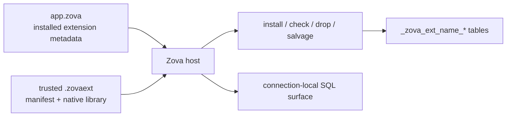

import Tabs from '@theme/Tabs';
import TabItem from '@theme/TabItem';

# Extensions

Extensions add trusted native behavior and private Zova-owned metadata. They can register SQL functions or virtual tables, manage namespaced storage, and participate in install, health-check, drop, and salvage workflows.

The central rule is simple: **a database can require extension code, but it can never cause that code to load by itself**.

## Database state is not executable code

An installed extension has two parts:

1. Metadata in the `.zova` file records the extension name, version, storage prefix, and manifest expectations.
2. The application or CLI process provides matching trusted code.



Opening a database with a required extension whose code is unavailable fails clearly. Zova does not ignore the requirement, search arbitrary library paths, or load executable bytes from the database.

## Extension sources

The process can provide extensions in four ways:

- bundled extensions shipped with Zova, such as `trgm`;
- app-registered native Zig extensions;
- explicitly supplied and trusted local `.zovaext` bundles; or
- since 1.3.0, plugin descriptors linked into the host process, through the C ABI and Zig.

Since 1.2.0, the Rust, Python, Go, and JavaScript bindings select trusted bundles at create/open, as shown in [Load bundles from an application](#load-bundles-from-an-application). They do not provide extension-authoring APIs. Native Zig, the CLI, and the C ABI expose the widest host surface.

## Trust a local bundle

A `.zovaext` bundle is a local directory containing a manifest, a platform-native library, and any files that library depends on. Verify and trust it before use:

```sh
zova extension verify --smoke ./my_ext.zovaext
zova extension trust ./my_ext.zovaext
zova extension trusted
```

Trust records include the canonical bundle path, extension identity, manifest hash, library hash, and a bundle-wide content hash covering every other file in the bundle, dependencies included. If the manifest, native library, or any other bundle file changes, loading fails until the changed bundle is reviewed and trusted again.

Trust means permission to execute native code in the current process. Apply the same review, provenance, signing, and distribution controls used for an application binary.

## Supply and install the extension

Trust does not put code into a database. Supply the bundle to the process that opens it, then install its metadata and private storage:

```sh
zova --extension ./my_ext.zovaext \
  extension install app.zova my_ext

zova --extension ./my_ext.zovaext \
  extension check app.zova my_ext
```

Future commands that need the dynamic extension must supply it again with `--extension`, or run in a host application that registers it. A receiving machine cannot open the file successfully merely because the sender trusted the bundle.

Bundled extensions are already present in the normal process registry:

```sh
zova extension install app.zova trgm
zova extension check app.zova trgm
```

## Load bundles from an application

Applications select bundles explicitly every time they create or open a database that needs them. Trust the bundle first with `zova extension trust`; opening never grants trust or loads paths from database metadata.

<Tabs groupId="programming-languages" defaultValue="javascript">
  <TabItem value="javascript" label="JavaScript / TypeScript">

```ts
const extensions = { bundlePaths: ["./search.zovaext"] };
const db = Database.create("app.zova", extensions);
db.installExtension("search");
db.close();
const reopened = Database.open("app.zova", { readOnly: true, extensions });
```

  </TabItem>
  <TabItem value="rust" label="Rust">

```rust
let extensions = zova::ExtensionOptions {
    bundle_paths: vec!["./search.zovaext".into()],
    trust_store_path: None,
};
let mut db = zova::Database::create_with_extensions("app.zova", &extensions)?;
db.install_extension("search")?;
```

  </TabItem>
  <TabItem value="python" label="Python">

```python
db = zova.Database.create("app.zova", extension_bundles=["./search.zovaext"])
db.install_extension("search")
db.close()
db = zova.Database.open("app.zova", read_only=True,
                        extension_bundles=["./search.zovaext"])
```

  </TabItem>
  <TabItem value="go" label="Go">

```go
extensions := zova.ExtensionOptions{BundlePaths: []string{"./search.zovaext"}}
db, err := zova.CreateWithExtensions("app.zova", extensions)
// Reopen: zova.OpenWithExtensions(path, zova.OpenOptions{}, extensions).
```

  </TabItem>
</Tabs>

Each binding also accepts a trust-store path when the application does not use Zova's default store. Loaded libraries stay alive until the database and its child handles close. A bundle and its runtime dependencies must match the host OS, CPU, deployment target, and runtime ABI.

A C host can go further and link plugin code into its own executable. Linked `zova_plugin_descriptor_v1` pointers need no bundle and no trust record, because the host already runs that code. A database with a linked plugin installed must be opened with that plugin supplied every time. See the [Extension reference](../reference/extension-api.md#c-abi-host-surface).

## Storage ownership

Each extension owns only tables under its reserved prefix:

```text
_zova_ext_<extension-name>_*
```

For example, `trgm` owns `_zova_ext_trgm_*`. It must not mutate application tables or another extension's private storage through lifecycle hooks.

The installed-extension registry and extension-private tables remain in the main database even when object, vector, or graph stores are bound. Extension rows may refer to specialized targets through public Zova identities, but their own index storage is not routed to a bound store.

## Lifecycle hooks

Zova manages extension transitions:

- **install** creates namespaced private storage and records installed metadata;
- **check** validates the extension's own invariants;
- **drop** removes its private storage before removing installed metadata; and
- **salvage**, when provided, decides how recoverable private data is copied or rebuilt.

Install, check, and drop execute inside Zova-managed boundaries. If a hook fails, the lifecycle operation does not leave a partially accepted extension state. Drop also fails when unexpected owned storage remains.

Core Zova never guesses the meaning of `_zova_ext_*` tables. During salvage, an available trusted hook may copy, rebuild, or skip private storage. Without that hook, Zova reports and skips the extension data rather than copying an unknown schema as if it were healthy.

## ABI compatibility

The bundle manifest declares `zova_abi_min` as `major.minor.patch`. Before loading code, Zova rejects:

- malformed semantic versions;
- a required ABI newer than the running host; and
- invalid names, paths, lengths, or entrypoint metadata.

The host validates the declared numeric ABI minimum; still test trusted native code against every supported platform and deployment artifact. A plugin that uses an operation added in a later 1.x release must declare that release as its minimum. For example, plugins using the 1.3.0 keyed graph adjacency or edge-payload reads declare `zova_abi_min` `1.3.0`, and a 1.2.0 host rejects them.

## Author against the common C plugin ABI

Since 1.2.0, the supported authoring contract is the common C plugin ABI v1 in `include/zova_plugin.h`. Plugins written in C, C++, Rust, Zig, or another language that preserves C layouts and calling conventions export `zova_plugin_entry_v1` and return a descriptor. The host offers negotiated services for read-only SQL, diagnostics, bounded graph and vector reads, plugin-owned storage, SQL operation registration, and vector change history. See [Host services](../reference/extension-api.md#host-services).

Operations a plugin registers become ordinary SQL functions and table-valued functions named `zova_<extension>_<operation>`, so applications call them through prepared statements in any binding.

## Reference extensions

Two experimental reference extensions in the Zova repository are built only on the public plugin ABI:

- **NetworKit PageRank** computes PageRank over bounded graph scans and returns results as SQL table rows.
- **USearch HNSW** maintains a persistent approximate-nearest-neighbor index that stays consistent with its source vectors through transactional change tracking.

They are not bundled with Zova. Build them separately, then verify, trust, and supply them like any other bundle. Core vector search stays exact whether or not an approximate index is installed.

## Build an experimental Zig extension

The CLI can scaffold the legacy Zig bundle shape:

```sh
zova extension scaffold ./sample_ext \
  --name sample_ext \
  --version 0.1.0

zova extension build ./sample_ext
zova extension pack ./sample_ext \
  --out ./sample_ext.zovaext
zova extension verify --smoke ./sample_ext.zovaext
```

The smoke verification loads the bundle, creates a temporary database, installs the extension, runs its check hook, and reopens the database with the same bundle. It is a packaging and lifecycle check, not a substitute for extension-specific tests.

The bundle producer and legacy Zig descriptors remain experimental, not a second stable ABI. There is no high-level JavaScript, TypeScript, Python, or Go authoring SDK in v1.3.0.

## Runtime artifact differences

Since 1.2.0, dynamic bundle loading works in native Zig, the CLI, C ABI archives, and generated-C language packages on Linux, macOS, and Windows. Packages from 1.1.0 and earlier do not gain this retroactively.

On Windows, Zova loads the bundle library with dependency search restricted to the bundle directory: sibling DLL dependencies resolve, the process current directory is never searched, and a dependency replaced after trust is rejected before any of its code runs.

Bundled extensions such as `trgm` remain available in every binding because their code is already compiled into the process. The browser `zova-wasm` package cannot load native bundles.

## Move and recover extension databases

When moving a database, move or document its required extension artifacts separately. On the receiving system:

1. Verify the extension source and native platform match.
2. Verify the bundle.
3. Trust it locally.
4. Supply it to `doctor`, `check`, and the application open path.

```sh
zova extension trust ./my_ext.zovaext
zova --extension ./my_ext.zovaext doctor app.zova
```

Read the [Extension reference](../reference/extension-api.md) for the manifest and command contract. Use [Diagnostics and salvage](../operations/diagnostics.md) when extension code or private storage is missing or damaged.
