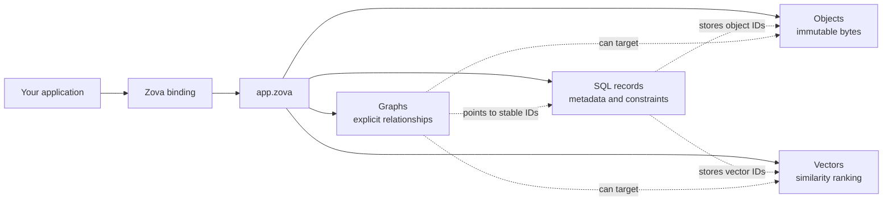

# Zova documentation

Zova is an embedded database for applications that need more than rows but do not want to operate a separate storage service. It keeps SQLite as the relational core, then adds content-addressed objects, exact-search vectors, and directed graphs inside the same local database model.

This combination is useful for document tools, local-first applications, desktop software, developer tools, and embedded services where metadata, files, embeddings, and relationships belong together. There is no daemon to start and no network protocol between the application and its data. The database is a `.zova` file opened directly by your process.

:::warning[Pre-1.0 compatibility]
Zova 0.26.1 writes file format 9. Format 9 was introduced in Zova 0.25. Zova does not migrate format-8 databases in place, so export with a compatible format-8 release before creating and importing into a format-9 database.
:::

## One database, four data shapes

Most applications do not have one kind of data. A document library, for example, may need:

- a SQL row containing the title, owner, media type, and timestamps;
- the original file bytes;
- an embedding used to find semantically similar documents; and
- relationships such as “belongs to project” or “derived from.”

Zova gives each concern a storage shape with a clear responsibility.

| Shape | Store here | Identity |
|---|---|---|
| **Records** | metadata, constraints, indexes, joins, views, and application state | your SQL primary keys |
| **Objects** | immutable files, payloads, and byte sequences | SHA-256 of the complete bytes |
| **Vectors** | embeddings and compact numeric features | collection name + application vector ID |
| **Graphs** | explicit relationships between stable entities | graph name + application node ID |

The boundary is deliberate: **metadata remains relational**. Objects, vectors, and graphs complement SQL rather than replacing it.



## Application data and Zova-owned data

Your application owns its SQL schema. Zova owns private tables whose names begin with `_zova_`. You query and migrate your tables normally; you access Zova-owned storage through a binding, the CLI, or Zova's registered SQL helpers.

A typical application row stores references rather than duplicating specialized data:

```sql
create table documents(
  id integer primary key,
  title text not null,
  object_id blob not null,
  vector_id text unique,
  graph_node_id text unique,
  created_at text not null
);
```

Here, `title` and `created_at` are relational metadata. `object_id` identifies bytes stored by the object layer. `vector_id` connects the row to an embedding, and `graph_node_id` gives the same document a stable identity in a graph.

Zova does not scan arbitrary application tables when an object, vector, or graph node is deleted. That would make private storage unexpectedly control your schema. Referential lifecycle remains explicit application policy.

## How a request moves through Zova

Suppose a user adds a PDF to a local knowledge base:

1. The application stores the PDF bytes as an object and receives an `ObjectId`.
2. It inserts a SQL row containing the filename, media type, and object ID.
3. After producing an embedding, it writes that vector under an application-chosen ID and records the ID in SQL.
4. It creates graph nodes and edges only for relationships the application needs to traverse.
5. Later, SQL narrows by metadata, vector search ranks candidates, and graph traversal expands explicit relationships.

No layer attempts to infer the others. The application chooses when to connect them, which keeps storage behavior visible and testable.

## SQLite is still the database engine

Zova does not replace SQLite semantics:

- SQL is SQLite SQL.
- Locking and concurrent-handle behavior follow SQLite.
- Transactions and savepoints remain connection-local.
- Journal mode, synchronous mode, and auto-vacuum remain application choices; format-9 handles start with foreign-key enforcement enabled.
- Zova does not silently run `VACUUM` or rewrite your tables.

Connections opened through Zova also register read-only helpers for vector distance, vector search, graph neighbors, and bounded graph walks. This lets specialized results join directly to application tables without exposing Zova's private schema.

## Single-file by default

A normal `.zova` file supports all four storage shapes. Start there. A single file is easier to move, back up, restore, and reason about.

When object bytes, vector rows, or graph topology need a separate placement lifecycle, the main database can optionally bind one store of each type. The API remains the same after opening the database, but SQLite attaches the external files and Zova validates their identities and consistency markers.

Bound stores are a local operational choice. They are not remote storage, replication, cloud synchronization, or a stronger transaction system. Read [Optional bound stores](./guides/bound-stores.md) before splitting a database.

## Choose the next chapter

If you are new to Zova, follow the path in order:

1. [Install Zova](./get-started/installation.md) for your language or platform.
2. [Build your first database](./get-started/first-database.md) using SQL records and object storage together.
3. Learn the individual storage models: [records](./core/records.md), [objects](./core/objects.md), [vectors](./core/vectors.md), and [graphs](./core/graphs.md).
4. Review [operational safety](./operations/safety.md) before putting important data into production.

If you already have a SQLite application, start with [Migrate from SQLite](./guides/sqlite-migration.md). If you are evaluating a specific capability, begin with its core chapter and continue into the linked guide.
