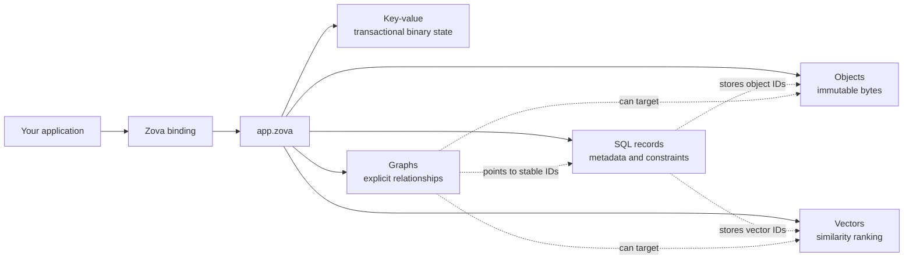

import Tabs from '@theme/Tabs';
import TabItem from '@theme/TabItem';

# Zova documentation

Zova is an embedded database for applications that need more than rows but do not want to operate a separate storage service. It keeps SQLite as the relational core, then adds transactional binary key-value storage, content-addressed objects, exact-search vectors, and directed graphs inside the same local database model.

This combination is useful for document tools, local-first applications, desktop software, developer tools, and embedded services where metadata, files, embeddings, and relationships belong together. There is no daemon to start and no network protocol between the application and its data. The database is a `.zova` file opened directly by your process.

## A first taste

This program creates an in-memory database, stores a file's bytes as an object, records it in a SQL row, and reads the bytes back:

<Tabs groupId="programming-languages" defaultValue="javascript">
  <TabItem value="javascript" label="JavaScript">

```js
import { Database } from "zova-js";

const db = Database.createMemory();
db.exec("create table notes(id integer primary key, title text, object_id blob)");
const objectId = db.putObject(new TextEncoder().encode("Hello from Zova"));
const insert = db.prepare("insert into notes(title, object_id) values (?1, ?2)");
insert.bindText(1, "hello.txt");
insert.bindBlob(2, objectId);
insert.step();
insert.close();
console.log(new TextDecoder().decode(db.getObject(objectId)));
db.close();
```

  </TabItem>
  <TabItem value="python" label="Python">

```python
import zova

with zova.Database.create_memory() as db:
    db.exec("create table notes(id integer primary key, title text, object_id blob)")
    object_id = db.put_object(b"Hello from Zova")
    with db.prepare("insert into notes(title, object_id) values (?1, ?2)") as insert:
        insert.bind_text(1, "hello.txt")
        insert.bind_blob(2, bytes(object_id))
        insert.step()
    print(db.get_object(object_id).decode())
```

  </TabItem>
  <TabItem value="rust" label="Rust">

```rust
use zova::{Database, Step};

fn main() -> Result<(), zova::Error> {
    let mut db = Database::create_memory()?;
    db.exec("create table notes(id integer primary key, title text, object_id blob)")?;
    let object_id = db.put_object(b"Hello from Zova")?;
    let mut insert = db.prepare("insert into notes(title, object_id) values (?1, ?2)")?;
    insert.bind_text(1, "hello.txt")?;
    insert.bind_blob(2, object_id.as_ref())?;
    assert_eq!(insert.step()?, Step::Done);
    drop(insert);
    println!("{}", String::from_utf8_lossy(&db.get_object(object_id)?));
    Ok(())
}
```

  </TabItem>
  <TabItem value="go" label="Go">

```go
package main

import (
	"fmt"
	"log"

	zova "github.com/ata-sesli/zova/bindings/go"
)

func main() {
	db, err := zova.CreateMemory()
	must(err)
	defer db.Close()

	must(db.Exec("create table notes(id integer primary key, title text, object_id blob)"))
	objectID, err := db.PutObject([]byte("Hello from Zova"))
	must(err)
	insert, err := db.Prepare("insert into notes(title, object_id) values (?1, ?2)")
	must(err)
	must(insert.BindText(1, "hello.txt"))
	must(insert.BindBlob(2, objectID[:]))
	_, err = insert.Step()
	must(err)
	must(insert.Close())
	body, err := db.GetObject(objectID)
	must(err)
	fmt.Println(string(body))
}

func must(err error) {
	if err != nil {
		log.Fatal(err)
	}
}
```

  </TabItem>
</Tabs>

It prints `Hello from Zova`. The row holds the metadata; the object holds the bytes, identified by their SHA-256 hash. The [tutorial](./get-started/first-database.md) builds a complete document library on this pattern, one storage shape at a time.

Upgrading an existing file? Zova 1.4 writes format 13 and never migrates on open. See [Upgrade an older Zova file](./guides/migrate-format.md) and [Compatibility](./operations/compatibility.md).

## One database, five data shapes

Most applications do not have one kind of data. A document library, for example, may need:

- a SQL row containing the title, owner, media type, and timestamps;
- the original file bytes;
- an embedding used to find semantically similar documents; and
- relationships such as “belongs to project” or “derived from.”

Zova gives each concern a storage shape with a clear responsibility.

| Shape | Store here | Identity |
|---|---|---|
| **Records** | metadata, constraints, indexes, joins, views, and application state | your SQL primary keys |
| **Key-value** | transactional binary state, caches, checkpoints, and namespaced values | namespace + byte key |
| **Objects** | immutable files, payloads, and byte sequences | SHA-256 of the complete bytes |
| **Vectors** | embeddings and compact numeric features | collection name + application vector ID |
| **Graphs** | explicit relationships between stable entities | graph name + application node ID |

The boundary is deliberate: **metadata remains relational**. Objects, vectors, and graphs complement SQL rather than replacing it.



## Application data and Zova-owned data

Your application owns its SQL schema. Zova owns private tables whose names begin with `_zova_`. You query and migrate your tables normally; you access Zova-owned storage through a binding, the CLI, or Zova's registered SQL helpers.

A typical application row stores references rather than duplicating specialized data:

```sql
create table documents(
  id integer primary key,
  title text not null,
  object_id blob not null,
  vector_id text unique,
  graph_node_id text unique,
  created_at text not null
);
```

Here, `title` and `created_at` are relational metadata. `object_id` identifies bytes stored by the object layer. `vector_id` connects the row to an embedding, and `graph_node_id` gives the same document a stable identity in a graph.

Zova does not scan arbitrary application tables when an object, vector, or graph node is deleted. That would make private storage unexpectedly control your schema. Referential lifecycle remains explicit application policy.

## How a request moves through Zova

Suppose a user adds a PDF to a local knowledge base:

1. The application stores the PDF bytes as an object and receives an `ObjectId`.
2. It inserts a SQL row containing the filename, media type, and object ID.
3. After producing an embedding, it writes that vector under an application-chosen ID and records the ID in SQL.
4. It creates graph nodes and edges only for relationships the application needs to traverse.
5. Later, SQL narrows by metadata, vector search ranks candidates, and graph traversal expands explicit relationships.

No layer attempts to infer the others. The application chooses when to connect them, which keeps storage behavior visible and testable.

## SQLite is still the database engine

Zova does not replace SQLite semantics:

- SQL is SQLite SQL.
- Locking and concurrent-handle behavior follow SQLite.
- Transactions and savepoints remain connection-local.
- Journal mode and synchronous mode remain application choices; format-13 handles start with foreign-key enforcement enabled.
- Files Zova creates use SQLite incremental auto-vacuum, so free pages can be released on request; Zova never vacuums automatically.
- Zova does not silently run `VACUUM` or rewrite your tables.

Connections opened through Zova also register read-only helpers for vector distance, vector search, graph neighbors, and bounded graph walks. This lets specialized results join directly to application tables without exposing Zova's private schema.

## Single-file by default

A normal `.zova` file supports all five storage shapes. Start there. A single file is easier to move, back up, restore, and reason about.

When object bytes, vector rows, or graph topology need a separate placement lifecycle, the main database can optionally bind one store of each type. The API remains the same after opening the database, but SQLite attaches the external files and Zova validates their identities and consistency markers.

Bound stores are a local operational choice. They are not remote storage, replication, cloud synchronization, or a stronger transaction system. Read [Optional bound stores](./guides/bound-stores.md) before splitting a database.

## File-backed or in-memory

Zova also provides first-class in-memory databases across native bindings. They expose the same SQL, KV, object, vector, graph, transaction, backup/restore, and app-event behavior without a durable file. Each database is private to its handle and disappears when that handle closes.

Use in-memory mode for tests, disposable transformations, and process-local state. Use a file-backed database when data must survive process exit.

## Choose the next chapter

The documentation is organized by what you are trying to do:

| You want to | Read |
|---|---|
| learn Zova by building something | the **Tutorial**: [install](./get-started/installation.md), then parts [1](./get-started/first-database.md) to [5](./tutorial/maintain.md) |
| understand how a storage shape behaves | **Concepts**: [records](./core/records.md), [key-value](./core/key-value.md), [objects](./core/objects.md), [vectors](./core/vectors.md), [graphs](./core/graphs.md), [SQL helpers](./core/sql.md) |
| complete a specific task | **How-to guides**, such as [Migrate from SQLite](./guides/sqlite-migration.md) or [Reclaim disk space](./guides/reclaim-space.md) |
| look up a call in your language | **Bindings**: [JavaScript](./bindings/javascript.md), [Python](./bindings/python.md), [Rust](./bindings/rust.md), [Go](./bindings/go.md), [C ABI](./bindings/c-abi.md), [Zig](./bindings/zig.md) |
| run Zova in production | **Operations**, starting with [operational safety](./operations/safety.md) |

If you are new to Zova, start the tutorial. If you already have a SQLite application, start with [Migrate from SQLite](./guides/sqlite-migration.md).
