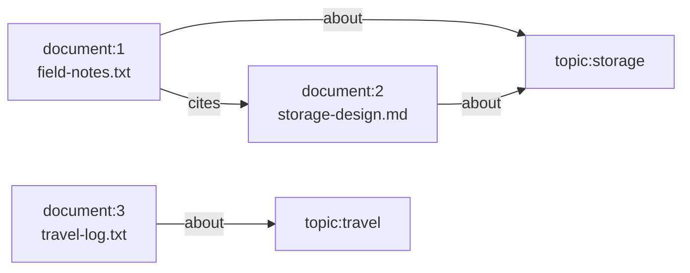

import Tabs from '@theme/Tabs';
import TabItem from '@theme/TabItem';

# Tutorial part 3: Relate documents

Similarity search finds documents that *look* alike. Some relationships are facts instead: this document is about storage, and that one cites another. In this part you record those facts as a graph, query them, and join the graph back to your SQL rows.

## What you will build in this part

- graph nodes for the three documents, pointing back to their rows;
- graph nodes for two topics, `storage` and `travel`; and
- typed, directed edges for `about` and `cites`.



## Step 1: Add nodes

<Tabs groupId="programming-languages" defaultValue="javascript">
  <TabItem value="javascript" label="JavaScript">

```js
db.createGraph(graphName);
db.transaction((tx) => {
  for (const id of [1, 2, 3]) {
    tx.putGraphNode({
      graphName,
      nodeId: `document:${id}`,
      kind: "document",
      targetType: "record",
      targetNamespace: "documents",
      targetRef: String(id),
    });
  }
  for (const topic of ["storage", "travel"]) {
    tx.putGraphNode({
      graphName,
      nodeId: `topic:${topic}`,
      kind: "topic",
      targetType: "entity",
      targetRef: topic,
    });
  }
```

  </TabItem>
  <TabItem value="python" label="Python">

```python
db.create_graph(G)
db.begin_immediate()
for doc_id in (1, 2, 3):
    db.put_graph_node(zova.GraphNodeInput(
        G, f"document:{doc_id}", "document",
        zova.GraphTargetType.RECORD, "documents", str(doc_id)))
for topic in ("storage", "travel"):
    db.put_graph_node(zova.GraphNodeInput(
        G, f"topic:{topic}", "topic", zova.GraphTargetType.ENTITY, None, topic))
```

  </TabItem>
  <TabItem value="rust" label="Rust">

```rust
db.create_graph(DEFAULT_GRAPH_NAME)?;

db.begin_immediate()?;
for id in ["1", "2", "3"] {
    db.put_graph_node(GraphNodeInput {
        graph_name: DEFAULT_GRAPH_NAME,
        node_id: &format!("document:{id}"),
        kind: "document",
        target_type: GraphTargetType::Record,
        target_namespace: Some("documents"),
        target_ref: Some(id),
    })?;
}
for topic in ["storage", "travel"] {
    db.put_graph_node(GraphNodeInput {
        graph_name: DEFAULT_GRAPH_NAME,
        node_id: &format!("topic:{topic}"),
        kind: "topic",
        target_type: GraphTargetType::Entity,
        target_namespace: None,
        target_ref: Some(topic),
    })?;
}
```

  </TabItem>
  <TabItem value="go" label="Go">

```go
must(db.CreateGraph(graph))
must(db.BeginImmediate())
for _, id := range []string{"1", "2", "3"} {
	must(db.PutGraphNode(zova.GraphNodeInput{
		GraphName:       graph,
		NodeID:          "document:" + id,
		Kind:            "document",
		TargetType:      zova.GraphTargetRecord,
		TargetNamespace: ptr("documents"),
		TargetRef:       ptr(id),
	}))
}
for _, topic := range []string{"storage", "travel"} {
	must(db.PutGraphNode(zova.GraphNodeInput{
		GraphName:  graph,
		NodeID:     "topic:" + topic,
		Kind:       "topic",
		TargetType: zova.GraphTargetEntity,
		TargetRef:  ptr(topic),
	}))
}
```

  </TabItem>
</Tabs>

The program first creates a graph named `default`, which Python, Rust, and Go also expose as a constant. Each node has an application-chosen ID, a `kind` label, and a **target** that says what the node represents:

- A **record** target names an application row by namespace and reference, here table `documents` and row ID `1`.
- An **entity** target represents a concept that has no row of its own, such as a topic.

Zova validates targets it owns, such as objects and vectors. It cannot check that row `1` exists in your `documents` table; that reference is your contract.

## Step 2: Add edges

<Tabs groupId="programming-languages" defaultValue="javascript">
  <TabItem value="javascript" label="JavaScript">

```js
  tx.putGraphEdges([
    { graphName, fromNodeId: "document:1", edgeType: "about", toNodeId: "topic:storage" },
    { graphName, fromNodeId: "document:2", edgeType: "about", toNodeId: "topic:storage" },
    { graphName, fromNodeId: "document:3", edgeType: "about", toNodeId: "topic:travel" },
    { graphName, fromNodeId: "document:1", edgeType: "cites", toNodeId: "document:2" },
  ]);
});
```

  </TabItem>
  <TabItem value="python" label="Python">

```python
for source, edge_type, target in [
    ("document:1", "about", "topic:storage"),
    ("document:2", "about", "topic:storage"),
    ("document:3", "about", "topic:travel"),
    ("document:1", "cites", "document:2"),
]:
    db.put_graph_edge(zova.GraphEdgeInput(G, source, edge_type, target))
db.commit()
```

  </TabItem>
  <TabItem value="rust" label="Rust">

```rust
db.put_graph_edges(&[
    edge("document:1", "about", "topic:storage"),
    edge("document:2", "about", "topic:storage"),
    edge("document:3", "about", "topic:travel"),
    edge("document:1", "cites", "document:2"),
])?;
db.commit()?;
```

  </TabItem>
  <TabItem value="go" label="Go">

```go
for _, edge := range [][3]string{
	{"document:1", "about", "topic:storage"},
	{"document:2", "about", "topic:storage"},
	{"document:3", "about", "topic:travel"},
	{"document:1", "cites", "document:2"},
} {
	must(db.PutGraphEdge(zova.GraphEdgeInput{
		GraphName: graph, FromNodeID: edge[0], EdgeType: edge[1], ToNodeID: edge[2],
	}))
}
must(db.Commit())
```

  </TabItem>
</Tabs>

Edges are directed and typed. `document:1 --cites--> document:2` does not imply a reverse edge, but you can still traverse it from either end. Both endpoints must already exist. Nodes and edges are written in one transaction, so the graph never contains half of this structure.

## Step 3: Ask for neighbors

<Tabs groupId="programming-languages" defaultValue="javascript">
  <TabItem value="javascript" label="JavaScript">

```js
console.log("Documents about storage:");
const about = db.graphNeighbors({
  graphName,
  nodeId: "topic:storage",
  direction: "incoming",
  edgeType: "about",
  limit: 10,
});
for (const neighbor of about) console.log(`  ${neighbor.nodeId}`);
```

  </TabItem>
  <TabItem value="python" label="Python">

```python
print("Documents about storage:")
for neighbor in db.graph_neighbors(zova.GraphNeighborsOptions(
        G, "topic:storage", zova.GraphNeighborDirection.INCOMING, "about")):
    print(f"  {neighbor.node_id}")
```

  </TabItem>
  <TabItem value="rust" label="Rust">

```rust
println!("Documents about storage:");
for neighbor in db.graph_neighbors(GraphNeighborsOptions {
    graph_name: DEFAULT_GRAPH_NAME,
    node_id: "topic:storage",
    direction: GraphNeighborDirection::Incoming,
    edge_type: Some("about"),
    limit: 10,
})? {
    println!("  {}", neighbor.node_id);
}
```

  </TabItem>
  <TabItem value="go" label="Go">

```go
fmt.Println("Documents about storage:")
neighbors, err := db.GraphNeighbors(zova.GraphNeighborsOptions{
	GraphName: graph,
	NodeID:    "topic:storage",
	Direction: zova.GraphNeighborIncoming,
	EdgeType:  ptr("about"),
	Limit:     10,
})
must(err)
for _, neighbor := range neighbors {
	fmt.Printf("  %s\n", neighbor.NodeID)
}
```

  </TabItem>
</Tabs>

A neighbor query returns one hop. `incoming` follows edges that point *at* the node, so asking `topic:storage` for incoming `about` edges answers "which documents are about storage?".

## Step 4: Walk the graph

<Tabs groupId="programming-languages" defaultValue="javascript">
  <TabItem value="javascript" label="JavaScript">

```js
console.log("Reachable from document:1 within two hops:");
const walk = db.graphWalk({ graphName, startNodeId: "document:1", maxDepth: 2, limit: 10 });
for (const item of walk) {
  console.log(`  depth ${item.depth}: ${item.nodeId} via ${item.edgeType ?? "start"}`);
}
```

  </TabItem>
  <TabItem value="python" label="Python">

```python
print("Reachable from document:1 within two hops:")
for item in db.graph_walk(zova.GraphWalkOptions(G, "document:1", max_depth=2, limit=10)):
    print(f"  depth {item.depth}: {item.node_id} via {item.edge_type or 'start'}")
```

  </TabItem>
  <TabItem value="rust" label="Rust">

```rust
println!("Reachable from document:1 within two hops:");
for item in db.graph_walk(GraphWalkOptions {
    graph_name: DEFAULT_GRAPH_NAME,
    start_node_id: "document:1",
    edge_type: None,
    max_depth: 2,
    limit: 10,
})? {
    let via = item.edge_type.as_deref().unwrap_or("start");
    println!("  depth {}: {} via {via}", item.depth, item.node_id);
}
```

  </TabItem>
  <TabItem value="go" label="Go">

```go
fmt.Println("Reachable from document:1 within two hops:")
walk, err := db.GraphWalk(zova.GraphWalkOptions{
	GraphName: graph, StartNodeID: "document:1", MaxDepth: 2, Limit: 10,
})
must(err)
for _, item := range walk {
	via := "start"
	if item.EdgeType != nil {
		via = *item.EdgeType
	}
	fmt.Printf("  depth %d: %s via %s\n", item.Depth, item.NodeID, via)
}
```

  </TabItem>
</Tabs>

A walk is a breadth-first traversal bounded by `max_depth` and `limit`. It starts with the start node at depth 0, visits each reachable node once, and reports the edge type that reached it. `document:2` appears at depth 1 through `cites`, so the walk does not list it again at depth 2 through `topic:storage`.

## Step 5: Join the graph to SQL

<Tabs groupId="programming-languages" defaultValue="javascript">
  <TabItem value="javascript" label="JavaScript">

```js
console.log("Titles of documents cited by document:1:");
const query = db.prepare(`
  select d.title
  from zova_graph_neighbors as g
  join documents as d on 'document:' || d.id = g.node_id
  where g.graph_name = 'default' and g.source_node_id = 'document:1'
    and g.direction = 'outgoing' and g.edge_type = 'cites' and g."limit" = 10
  order by g.rank`);
while (query.step() === Step.Row) console.log(`  ${query.columnText(0)}`);
query.close();
```

  </TabItem>
  <TabItem value="python" label="Python">

```python
print("Titles of documents cited by document:1:")
with db.prepare(
    "select d.title "
    "from zova_graph_neighbors as g "
    "join documents as d on 'document:' || d.id = g.node_id "
    "where g.graph_name = 'default' and g.source_node_id = 'document:1' "
    "and g.direction = 'outgoing' and g.edge_type = 'cites' and g.\"limit\" = 10 "
    "order by g.rank"
) as query:
    while query.step() == zova.Step.ROW:
        print(f"  {query.column_text(0)}")
```

  </TabItem>
  <TabItem value="rust" label="Rust">

```rust
println!("Titles of documents cited by document:1:");
let mut query = db.prepare(
    "select d.title \
     from zova_graph_neighbors as g \
     join documents as d on 'document:' || d.id = g.node_id \
     where g.graph_name = 'default' and g.source_node_id = 'document:1' \
       and g.direction = 'outgoing' and g.edge_type = 'cites' and g.\"limit\" = 10 \
     order by g.rank",
)?;
while query.step()? == Step::Row {
    println!("  {}", query.column_text(0)?.unwrap());
}
```

  </TabItem>
  <TabItem value="go" label="Go">

```go
fmt.Println("Titles of documents cited by document:1:")
query, err := db.Prepare(`select d.title
	from zova_graph_neighbors as g
	join documents as d on 'document:' || d.id = g.node_id
	where g.graph_name = 'default' and g.source_node_id = 'document:1'
	  and g.direction = 'outgoing' and g.edge_type = 'cites' and g."limit" = 10
	order by g.rank`)
must(err)
defer query.Close()
for {
	step, err := query.Step()
	must(err)
	if step != zova.StepRow {
		break
	}
	title, _, err := query.ColumnText(0)
	must(err)
	fmt.Printf("  %s\n", title)
}
```

  </TabItem>
</Tabs>

`zova_graph_neighbors` is the SQL form of the neighbor query. Its `node_id` column joins to your rows by the same ID scheme you chose in step 1. `zova_graph_walk` does the same for walks; see [Graph traversal](../guides/graph-traversal.md).

## Run it

<Tabs groupId="programming-languages" defaultValue="javascript">
  <TabItem value="javascript" label="JavaScript">

```sh
node relate.mjs
```

  </TabItem>
  <TabItem value="python" label="Python">

```sh
uv run relate.py
```

  </TabItem>
  <TabItem value="rust" label="Rust">

```sh
cargo run --bin relate
```

  </TabItem>
  <TabItem value="go" label="Go">

```sh
go run ./relate
```

  </TabItem>
</Tabs>

Expected output:

```text
Documents about storage:
  document:1
  document:2
Reachable from document:1 within two hops:
  depth 0: document:1 via start
  depth 1: topic:storage via about
  depth 1: document:2 via cites
Titles of documents cited by document:1:
  storage-design.md
```

## The complete program

<Tabs groupId="programming-languages" defaultValue="javascript">
  <TabItem value="javascript" label="JavaScript">

```js title="relate.mjs"
import { Database, Step } from "zova-js";

const graphName = "default";
const db = Database.open("library.zova");
try {
  db.createGraph(graphName);
  db.transaction((tx) => {
    for (const id of [1, 2, 3]) {
      tx.putGraphNode({
        graphName,
        nodeId: `document:${id}`,
        kind: "document",
        targetType: "record",
        targetNamespace: "documents",
        targetRef: String(id),
      });
    }
    for (const topic of ["storage", "travel"]) {
      tx.putGraphNode({
        graphName,
        nodeId: `topic:${topic}`,
        kind: "topic",
        targetType: "entity",
        targetRef: topic,
      });
    }
    tx.putGraphEdges([
      { graphName, fromNodeId: "document:1", edgeType: "about", toNodeId: "topic:storage" },
      { graphName, fromNodeId: "document:2", edgeType: "about", toNodeId: "topic:storage" },
      { graphName, fromNodeId: "document:3", edgeType: "about", toNodeId: "topic:travel" },
      { graphName, fromNodeId: "document:1", edgeType: "cites", toNodeId: "document:2" },
    ]);
  });

  console.log("Documents about storage:");
  const about = db.graphNeighbors({
    graphName,
    nodeId: "topic:storage",
    direction: "incoming",
    edgeType: "about",
    limit: 10,
  });
  for (const neighbor of about) console.log(`  ${neighbor.nodeId}`);

  console.log("Reachable from document:1 within two hops:");
  const walk = db.graphWalk({ graphName, startNodeId: "document:1", maxDepth: 2, limit: 10 });
  for (const item of walk) {
    console.log(`  depth ${item.depth}: ${item.nodeId} via ${item.edgeType ?? "start"}`);
  }

  console.log("Titles of documents cited by document:1:");
  const query = db.prepare(`
    select d.title
    from zova_graph_neighbors as g
    join documents as d on 'document:' || d.id = g.node_id
    where g.graph_name = 'default' and g.source_node_id = 'document:1'
      and g.direction = 'outgoing' and g.edge_type = 'cites' and g."limit" = 10
    order by g.rank`);
  while (query.step() === Step.Row) console.log(`  ${query.columnText(0)}`);
  query.close();
} finally {
  db.close();
}
```

  </TabItem>
  <TabItem value="python" label="Python">

```python title="relate.py"
import zova

G = zova.DEFAULT_GRAPH_NAME

with zova.Database.open("library.zova") as db:
    db.create_graph(G)
    db.begin_immediate()
    for doc_id in (1, 2, 3):
        db.put_graph_node(zova.GraphNodeInput(
            G, f"document:{doc_id}", "document",
            zova.GraphTargetType.RECORD, "documents", str(doc_id)))
    for topic in ("storage", "travel"):
        db.put_graph_node(zova.GraphNodeInput(
            G, f"topic:{topic}", "topic", zova.GraphTargetType.ENTITY, None, topic))
    for source, edge_type, target in [
        ("document:1", "about", "topic:storage"),
        ("document:2", "about", "topic:storage"),
        ("document:3", "about", "topic:travel"),
        ("document:1", "cites", "document:2"),
    ]:
        db.put_graph_edge(zova.GraphEdgeInput(G, source, edge_type, target))
    db.commit()

    print("Documents about storage:")
    for neighbor in db.graph_neighbors(zova.GraphNeighborsOptions(
            G, "topic:storage", zova.GraphNeighborDirection.INCOMING, "about")):
        print(f"  {neighbor.node_id}")

    print("Reachable from document:1 within two hops:")
    for item in db.graph_walk(zova.GraphWalkOptions(G, "document:1", max_depth=2, limit=10)):
        print(f"  depth {item.depth}: {item.node_id} via {item.edge_type or 'start'}")

    print("Titles of documents cited by document:1:")
    with db.prepare(
        "select d.title "
        "from zova_graph_neighbors as g "
        "join documents as d on 'document:' || d.id = g.node_id "
        "where g.graph_name = 'default' and g.source_node_id = 'document:1' "
        "and g.direction = 'outgoing' and g.edge_type = 'cites' and g.\"limit\" = 10 "
        "order by g.rank"
    ) as query:
        while query.step() == zova.Step.ROW:
            print(f"  {query.column_text(0)}")
```

  </TabItem>
  <TabItem value="rust" label="Rust">

```rust title="src/bin/relate.rs"
use zova::{
    Database, GraphEdgeInput, GraphNeighborDirection, GraphNeighborsOptions, GraphNodeInput,
    GraphTargetType, GraphWalkOptions, Step, DEFAULT_GRAPH_NAME,
};

fn edge<'a>(from: &'a str, edge_type: &'a str, to: &'a str) -> GraphEdgeInput<'a> {
    GraphEdgeInput { graph_name: DEFAULT_GRAPH_NAME, from_node_id: from, edge_type, to_node_id: to }
}

fn main() -> Result<(), zova::Error> {
    let mut db = Database::open("library.zova")?;
    db.create_graph(DEFAULT_GRAPH_NAME)?;

    db.begin_immediate()?;
    for id in ["1", "2", "3"] {
        db.put_graph_node(GraphNodeInput {
            graph_name: DEFAULT_GRAPH_NAME,
            node_id: &format!("document:{id}"),
            kind: "document",
            target_type: GraphTargetType::Record,
            target_namespace: Some("documents"),
            target_ref: Some(id),
        })?;
    }
    for topic in ["storage", "travel"] {
        db.put_graph_node(GraphNodeInput {
            graph_name: DEFAULT_GRAPH_NAME,
            node_id: &format!("topic:{topic}"),
            kind: "topic",
            target_type: GraphTargetType::Entity,
            target_namespace: None,
            target_ref: Some(topic),
        })?;
    }
    db.put_graph_edges(&[
        edge("document:1", "about", "topic:storage"),
        edge("document:2", "about", "topic:storage"),
        edge("document:3", "about", "topic:travel"),
        edge("document:1", "cites", "document:2"),
    ])?;
    db.commit()?;

    println!("Documents about storage:");
    for neighbor in db.graph_neighbors(GraphNeighborsOptions {
        graph_name: DEFAULT_GRAPH_NAME,
        node_id: "topic:storage",
        direction: GraphNeighborDirection::Incoming,
        edge_type: Some("about"),
        limit: 10,
    })? {
        println!("  {}", neighbor.node_id);
    }

    println!("Reachable from document:1 within two hops:");
    for item in db.graph_walk(GraphWalkOptions {
        graph_name: DEFAULT_GRAPH_NAME,
        start_node_id: "document:1",
        edge_type: None,
        max_depth: 2,
        limit: 10,
    })? {
        let via = item.edge_type.as_deref().unwrap_or("start");
        println!("  depth {}: {} via {via}", item.depth, item.node_id);
    }

    println!("Titles of documents cited by document:1:");
    let mut query = db.prepare(
        "select d.title \
         from zova_graph_neighbors as g \
         join documents as d on 'document:' || d.id = g.node_id \
         where g.graph_name = 'default' and g.source_node_id = 'document:1' \
           and g.direction = 'outgoing' and g.edge_type = 'cites' and g.\"limit\" = 10 \
         order by g.rank",
    )?;
    while query.step()? == Step::Row {
        println!("  {}", query.column_text(0)?.unwrap());
    }
    Ok(())
}
```

  </TabItem>
  <TabItem value="go" label="Go">

```go title="relate/main.go"
package main

import (
	"fmt"
	"log"

	zova "github.com/ata-sesli/zova/bindings/go"
)

const graph = zova.DefaultGraphName

func ptr(s string) *string { return &s }

func main() {
	db, err := zova.Open("library.zova")
	must(err)
	defer db.Close()

	must(db.CreateGraph(graph))
	must(db.BeginImmediate())
	for _, id := range []string{"1", "2", "3"} {
		must(db.PutGraphNode(zova.GraphNodeInput{
			GraphName:       graph,
			NodeID:          "document:" + id,
			Kind:            "document",
			TargetType:      zova.GraphTargetRecord,
			TargetNamespace: ptr("documents"),
			TargetRef:       ptr(id),
		}))
	}
	for _, topic := range []string{"storage", "travel"} {
		must(db.PutGraphNode(zova.GraphNodeInput{
			GraphName:  graph,
			NodeID:     "topic:" + topic,
			Kind:       "topic",
			TargetType: zova.GraphTargetEntity,
			TargetRef:  ptr(topic),
		}))
	}
	for _, edge := range [][3]string{
		{"document:1", "about", "topic:storage"},
		{"document:2", "about", "topic:storage"},
		{"document:3", "about", "topic:travel"},
		{"document:1", "cites", "document:2"},
	} {
		must(db.PutGraphEdge(zova.GraphEdgeInput{
			GraphName: graph, FromNodeID: edge[0], EdgeType: edge[1], ToNodeID: edge[2],
		}))
	}
	must(db.Commit())

	fmt.Println("Documents about storage:")
	neighbors, err := db.GraphNeighbors(zova.GraphNeighborsOptions{
		GraphName: graph,
		NodeID:    "topic:storage",
		Direction: zova.GraphNeighborIncoming,
		EdgeType:  ptr("about"),
		Limit:     10,
	})
	must(err)
	for _, neighbor := range neighbors {
		fmt.Printf("  %s\n", neighbor.NodeID)
	}

	fmt.Println("Reachable from document:1 within two hops:")
	walk, err := db.GraphWalk(zova.GraphWalkOptions{
		GraphName: graph, StartNodeID: "document:1", MaxDepth: 2, Limit: 10,
	})
	must(err)
	for _, item := range walk {
		via := "start"
		if item.EdgeType != nil {
			via = *item.EdgeType
		}
		fmt.Printf("  depth %d: %s via %s\n", item.Depth, item.NodeID, via)
	}

	fmt.Println("Titles of documents cited by document:1:")
	query, err := db.Prepare(`select d.title
		from zova_graph_neighbors as g
		join documents as d on 'document:' || d.id = g.node_id
		where g.graph_name = 'default' and g.source_node_id = 'document:1'
		  and g.direction = 'outgoing' and g.edge_type = 'cites' and g."limit" = 10
		order by g.rank`)
	must(err)
	defer query.Close()
	for {
		step, err := query.Step()
		must(err)
		if step != zova.StepRow {
			break
		}
		title, _, err := query.ColumnText(0)
		must(err)
		fmt.Printf("  %s\n", title)
	}
}

func must(err error) {
	if err != nil {
		log.Fatal(err)
	}
}
```

  </TabItem>
</Tabs>

## Inspect the file

The CLI can run the same traversals:

```sh
zova graphs library.zova
zova graph-neighbors --incoming --edge-type about library.zova default topic:storage
zova graph-walk --max-depth 2 library.zova default document:1
```

`zova graphs` reports `default nodes=5 edges=4`, and the walk lists the same three nodes as your program.

## What you learned

- Graph nodes have application IDs and targets that point at rows or describe concepts.
- Edges are typed and directed, and traversal can follow them in either direction.
- Neighbor queries return one hop. Walks are breadth-first and bounded by depth and limit.
- Graph results join back to SQL through the IDs you chose.

**Next:** [Part 4: Keep app state and react to changes](./state.md) remembers where a reader stopped and tells other components when documents change.
