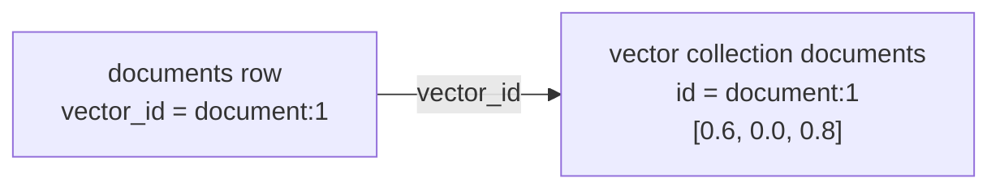

import Tabs from '@theme/Tabs';
import TabItem from '@theme/TabItem';

# Tutorial part 2: Search by meaning

In [part 1](../get-started/first-database.md) you stored three documents. Now you give each one an embedding and ask which documents are closest to a question. You rank them twice: once through the binding's search call and once inside SQL, joined to the titles.

## What you will build in this part

- a `vector_id` column on `documents`;
- a vector collection named `documents` with one three-dimensional vector per row; and
- three searches: by a query vector, by a query vector in SQL, and by a stored document's vector.



## Step 1: Choose the embeddings

<Tabs groupId="programming-languages" defaultValue="javascript">
  <TabItem value="javascript" label="JavaScript">

```js
// Stand-in embeddings: [storage, travel, notes]. Use your embedding model in a real app.
const embeddings = new Map([
  [1, [0.6, 0.0, 0.8]],
  [2, [1.0, 0.0, 0.1]],
  [3, [0.0, 1.0, 0.3]],
]);
const question = new Float32Array([0.9, 0.0, 0.2]);
```

  </TabItem>
  <TabItem value="python" label="Python">

```python
# Stand-in embeddings: [storage, travel, notes]. Use your embedding model in a real app.
EMBEDDINGS = {
    1: [0.6, 0.0, 0.8],
    2: [1.0, 0.0, 0.1],
    3: [0.0, 1.0, 0.3],
}
QUESTION = [0.9, 0.0, 0.2]
F32 = zova.VectorElementType.F32
```

  </TabItem>
  <TabItem value="rust" label="Rust">

```rust
// Stand-in embeddings: [storage, travel, notes]. Use your embedding model in a real app.
const EMBEDDINGS: [(i64, [f32; 3]); 3] = [
    (1, [0.6, 0.0, 0.8]),
    (2, [1.0, 0.0, 0.1]),
    (3, [0.0, 1.0, 0.3]),
];
const QUESTION: [f32; 3] = [0.9, 0.0, 0.2];
```

  </TabItem>
  <TabItem value="go" label="Go">

```go
// Stand-in embeddings: [storage, travel, notes]. Use your embedding model in a real app.
var embeddings = map[int64][]float32{
	1: {0.6, 0.0, 0.8},
	2: {1.0, 0.0, 0.1},
	3: {0.0, 1.0, 0.3},
}
var question = []float32{0.9, 0.0, 0.2}

func f32(values []float32) zova.VectorValues {
	return zova.VectorValues{ElementType: zova.VectorElementTypeF32, F32: values}
}
```

  </TabItem>
</Tabs>

A real application gets embeddings from a model, with hundreds of dimensions. This tutorial uses three hand-made dimensions so you can predict the results: `field-notes.txt` is about storage and notes, `storage-design.md` is mostly about storage, and `travel-log.txt` is about travel. The question vector leans toward storage.

## Step 2: Create a collection

<Tabs groupId="programming-languages" defaultValue="javascript">
  <TabItem value="javascript" label="JavaScript">

```js
db.exec("alter table documents add column vector_id text");
db.createVectorCollection("documents", {
  dimensions: 3,
  metric: "cosine",
  elementType: "f32",
});
```

  </TabItem>
  <TabItem value="python" label="Python">

```python
db.exec("alter table documents add column vector_id text")
db.create_vector_collection(
    "documents", zova.VectorCollectionOptions(3, zova.VectorMetric.COSINE, F32)
)
```

  </TabItem>
  <TabItem value="rust" label="Rust">

```rust
db.exec("alter table documents add column vector_id text")?;
db.create_vector_collection(
    "documents",
    VectorCollectionOptions {
        dimensions: 3,
        metric: VectorMetric::Cosine,
        element_type: VectorElementType::F32,
    },
)?;
```

  </TabItem>
  <TabItem value="go" label="Go">

```go
must(db.Exec("alter table documents add column vector_id text"))
must(db.CreateVectorCollection("documents", zova.VectorCollectionOptions{
	Dimensions:  3,
	Metric:      zova.VectorMetricCosine,
	ElementType: zova.VectorElementTypeF32,
}))
```

  </TabItem>
</Tabs>

A collection fixes three things for every vector it holds: the number of **dimensions**, the **metric** used to compare vectors, and the **element type**. Cosine distance compares direction and ignores length, which suits most text embeddings. Collections can also use Euclidean L2 or dot-product distance and raw `f16` or `i8` elements; see [Vectors](../core/vectors.md).

The new `vector_id` column connects a row to its vector. Zova does not scan your tables to discover that link, so you choose and store the ID.

## Step 3: Store vectors and link rows in one transaction

<Tabs groupId="programming-languages" defaultValue="javascript">
  <TabItem value="javascript" label="JavaScript">

```js
db.transaction((tx) => {
  tx.putVectors(
    "documents",
    [...embeddings].map(([id, values]) => ({
      id: `document:${id}`,
      values: new Float32Array(values),
    })),
  );
  for (const id of embeddings.keys()) {
    const update = tx.prepare("update documents set vector_id = ?1 where id = ?2");
    update.bindText(1, `document:${id}`);
    update.bindInteger(2, BigInt(id));
    update.step();
    update.close();
  }
});
```

  </TabItem>
  <TabItem value="python" label="Python">

```python
db.begin_immediate()
db.put_vectors(
    "documents",
    [zova.VectorInput(f"document:{doc_id}", F32, values) for doc_id, values in EMBEDDINGS.items()],
)
for doc_id in EMBEDDINGS:
    with db.prepare("update documents set vector_id = ?1 where id = ?2") as update:
        update.bind_text(1, f"document:{doc_id}")
        update.bind_int(2, doc_id)
        update.step()
db.commit()
```

  </TabItem>
  <TabItem value="rust" label="Rust">

```rust
let ids: Vec<String> = EMBEDDINGS.iter().map(|(id, _)| format!("document:{id}")).collect();
let inputs: Vec<VectorInput> = EMBEDDINGS
    .iter()
    .zip(&ids)
    .map(|((_, values), id)| VectorInput { id, values: VectorValues::F32(values) })
    .collect();

db.begin_immediate()?;
db.put_vectors("documents", &inputs)?;
for ((row_id, _), vector_id) in EMBEDDINGS.iter().zip(&ids) {
    let mut update = db.prepare("update documents set vector_id = ?1 where id = ?2")?;
    update.bind_text(1, vector_id)?;
    update.bind_i64(2, *row_id)?;
    update.step()?;
}
db.commit()?;
```

  </TabItem>
  <TabItem value="go" label="Go">

```go
must(db.BeginImmediate())
var inputs []zova.VectorInput
for id := int64(1); id <= 3; id++ {
	vectorID := fmt.Sprintf("document:%d", id)
	inputs = append(inputs, zova.VectorInput{ID: vectorID, Values: f32(embeddings[id])})
	update, err := db.Prepare("update documents set vector_id = ?1 where id = ?2")
	must(err)
	must(update.BindText(1, vectorID))
	must(update.BindInt64(2, id))
	_, err = update.Step()
	must(err)
	must(update.Close())
}
must(db.PutVectors("documents", inputs))
must(db.Commit())
```

  </TabItem>
</Tabs>

Writing the vectors and updating the rows in one transaction means a crash cannot leave a row pointing at a missing vector. The vector ID is an application string; `document:1` keeps it readable and unique within the collection.

## Step 4: Search with the binding

<Tabs groupId="programming-languages" defaultValue="javascript">
  <TabItem value="javascript" label="JavaScript">

```js
console.log("Closest to a storage question:");
for (const result of db.searchVectors("documents", question, { limit: 2 })) {
  console.log(`  ${result.id}  distance=${result.distance.toFixed(3)}`);
}
```

  </TabItem>
  <TabItem value="python" label="Python">

```python
print("Closest to a storage question:")
for result in db.search_vectors("documents", F32, QUESTION, 2):
    print(f"  {result.id}  distance={result.distance:.3f}")
```

  </TabItem>
  <TabItem value="rust" label="Rust">

```rust
println!("Closest to a storage question:");
for result in db.search_vectors("documents", VectorValues::F32(&QUESTION), 2)? {
    println!("  {}  distance={:.3}", result.id, result.distance);
}
```

  </TabItem>
  <TabItem value="go" label="Go">

```go
fmt.Println("Closest to a storage question:")
results, err := db.SearchVectors("documents", f32(question), 2)
must(err)
for _, result := range results {
	fmt.Printf("  %s  distance=%.3f\n", result.ID, result.Distance)
}
```

  </TabItem>
</Tabs>

`search_vectors` returns up to `limit` results ordered by distance, smallest first. Cosine distance is `1 − cosine similarity`, so `0` means the same direction. Search is exact: Zova compares the query with every vector in the collection and does not use an approximate index.

## Step 5: Search inside SQL

<Tabs groupId="programming-languages" defaultValue="javascript">
  <TabItem value="javascript" label="JavaScript">

```js
console.log("Ranked in SQL, joined to titles:");
const query = db.prepare(`
  select d.title, s.distance
  from zova_vector_search as s
  join documents as d on d.vector_id = s.vector_id
  where s.collection = 'documents' and s.query_vector = ?1 and s.top_k = 3
  order by s.rank`);
query.bindBlob(1, new Uint8Array(question.buffer));
while (query.step() === Step.Row) {
  console.log(`  ${query.columnText(0)}  distance=${query.columnFloat(1).toFixed(3)}`);
}
query.close();
```

  </TabItem>
  <TabItem value="python" label="Python">

```python
print("Ranked in SQL, joined to titles:")
with db.prepare(
    "select d.title, s.distance "
    "from zova_vector_search as s "
    "join documents as d on d.vector_id = s.vector_id "
    "where s.collection = 'documents' and s.query_vector = ?1 and s.top_k = 3 "
    "order by s.rank"
) as query:
    query.bind_blob(1, zova.encode_f32_le(QUESTION))
    while query.step() == zova.Step.ROW:
        print(f"  {query.column_text(0)}  distance={query.column_float(1):.3f}")
```

  </TabItem>
  <TabItem value="rust" label="Rust">

```rust
println!("Ranked in SQL, joined to titles:");
let query_bytes: Vec<u8> = QUESTION.iter().flat_map(|v| v.to_le_bytes()).collect();
let mut query = db.prepare(
    "select d.title, s.distance \
     from zova_vector_search as s \
     join documents as d on d.vector_id = s.vector_id \
     where s.collection = 'documents' and s.query_vector = ?1 and s.top_k = 3 \
     order by s.rank",
)?;
query.bind_blob(1, &query_bytes)?;
while query.step()? == Step::Row {
    println!("  {}  distance={:.3}", query.column_text(0)?.unwrap(), query.column_f64(1)?);
}
drop(query);
```

  </TabItem>
  <TabItem value="go" label="Go">

```go
fmt.Println("Ranked in SQL, joined to titles:")
queryBytes := make([]byte, 0, 4*len(question))
for _, v := range question {
	queryBytes = binary.LittleEndian.AppendUint32(queryBytes, math.Float32bits(v))
}
query, err := db.Prepare(`select d.title, s.distance
	from zova_vector_search as s
	join documents as d on d.vector_id = s.vector_id
	where s.collection = 'documents' and s.query_vector = ?1 and s.top_k = 3
	order by s.rank`)
must(err)
must(query.BindBlob(1, queryBytes))
for {
	step, err := query.Step()
	must(err)
	if step != zova.StepRow {
		break
	}
	title, _, err := query.ColumnText(0)
	must(err)
	distance, err := query.ColumnFloat64(1)
	must(err)
	fmt.Printf("  %s  distance=%.3f\n", title, distance)
}
must(query.Close())
```

  </TabItem>
</Tabs>

`zova_vector_search` is a read-only table-valued function registered on every connection Zova opens. You constrain it with `collection`, `query_vector`, and `top_k`, and it returns `vector_id`, `distance`, and `rank` columns that join to your tables. The query vector is a blob of little-endian `f32` values, the same layout the collection stores.

Use the SQL form when you need titles, permissions, or other columns in the same statement. [Combine vector search with SQL filters](../guides/vector-search.md) covers vector-first and SQL-first patterns for this join.

## Step 6: Find similar documents

<Tabs groupId="programming-languages" defaultValue="javascript">
  <TabItem value="javascript" label="JavaScript">

```js
console.log("More like document:1:");
for (const result of db.searchVectorsById("documents", "document:1", { limit: 2 })) {
  console.log(`  ${result.id}  distance=${result.distance.toFixed(3)}`);
}
```

  </TabItem>
  <TabItem value="python" label="Python">

```python
print("More like document:1:")
for result in db.search_vectors_by_id("documents", "document:1", 2):
    print(f"  {result.id}  distance={result.distance:.3f}")
```

  </TabItem>
  <TabItem value="rust" label="Rust">

```rust
println!("More like document:1:");
for result in db.search_vectors_by_id("documents", "document:1", 2)? {
    println!("  {}  distance={:.3}", result.id, result.distance);
}
```

  </TabItem>
  <TabItem value="go" label="Go">

```go
fmt.Println("More like document:1:")
similar, err := db.SearchVectorsByID("documents", "document:1", 2)
must(err)
for _, result := range similar {
	fmt.Printf("  %s  distance=%.3f\n", result.ID, result.Distance)
}
```

  </TabItem>
</Tabs>

`search_vectors_by_id` uses a stored vector as the query. It does not return the source vector itself, which is why `document:1` is missing from its own results.

## Run it

<Tabs groupId="programming-languages" defaultValue="javascript">
  <TabItem value="javascript" label="JavaScript">

```sh
node search.mjs
```

  </TabItem>
  <TabItem value="python" label="Python">

```sh
uv run search.py
```

  </TabItem>
  <TabItem value="rust" label="Rust">

```sh
cargo run --bin search
```

  </TabItem>
  <TabItem value="go" label="Go">

```sh
go run ./search
```

  </TabItem>
</Tabs>

Expected output:

```text
Closest to a storage question:
  document:2  distance=0.007
  document:1  distance=0.241
Ranked in SQL, joined to titles:
  storage-design.md  distance=0.007
  field-notes.txt  distance=0.241
  travel-log.txt  distance=0.938
More like document:1:
  document:2  distance=0.323
  document:3  distance=0.770
```

## The complete program

<Tabs groupId="programming-languages" defaultValue="javascript">
  <TabItem value="javascript" label="JavaScript">

```js title="search.mjs"
import { Database, Step } from "zova-js";

// Stand-in embeddings: [storage, travel, notes]. Use your embedding model in a real app.
const embeddings = new Map([
  [1, [0.6, 0.0, 0.8]],
  [2, [1.0, 0.0, 0.1]],
  [3, [0.0, 1.0, 0.3]],
]);
const question = new Float32Array([0.9, 0.0, 0.2]);

const db = Database.open("library.zova");
try {
  db.exec("alter table documents add column vector_id text");
  db.createVectorCollection("documents", {
    dimensions: 3,
    metric: "cosine",
    elementType: "f32",
  });

  db.transaction((tx) => {
    tx.putVectors(
      "documents",
      [...embeddings].map(([id, values]) => ({
        id: `document:${id}`,
        values: new Float32Array(values),
      })),
    );
    for (const id of embeddings.keys()) {
      const update = tx.prepare("update documents set vector_id = ?1 where id = ?2");
      update.bindText(1, `document:${id}`);
      update.bindInteger(2, BigInt(id));
      update.step();
      update.close();
    }
  });

  console.log("Closest to a storage question:");
  for (const result of db.searchVectors("documents", question, { limit: 2 })) {
    console.log(`  ${result.id}  distance=${result.distance.toFixed(3)}`);
  }

  console.log("Ranked in SQL, joined to titles:");
  const query = db.prepare(`
    select d.title, s.distance
    from zova_vector_search as s
    join documents as d on d.vector_id = s.vector_id
    where s.collection = 'documents' and s.query_vector = ?1 and s.top_k = 3
    order by s.rank`);
  query.bindBlob(1, new Uint8Array(question.buffer));
  while (query.step() === Step.Row) {
    console.log(`  ${query.columnText(0)}  distance=${query.columnFloat(1).toFixed(3)}`);
  }
  query.close();

  console.log("More like document:1:");
  for (const result of db.searchVectorsById("documents", "document:1", { limit: 2 })) {
    console.log(`  ${result.id}  distance=${result.distance.toFixed(3)}`);
  }
} finally {
  db.close();
}
```

  </TabItem>
  <TabItem value="python" label="Python">

```python title="search.py"
import zova

# Stand-in embeddings: [storage, travel, notes]. Use your embedding model in a real app.
EMBEDDINGS = {
    1: [0.6, 0.0, 0.8],
    2: [1.0, 0.0, 0.1],
    3: [0.0, 1.0, 0.3],
}
QUESTION = [0.9, 0.0, 0.2]
F32 = zova.VectorElementType.F32

with zova.Database.open("library.zova") as db:
    db.exec("alter table documents add column vector_id text")
    db.create_vector_collection(
        "documents", zova.VectorCollectionOptions(3, zova.VectorMetric.COSINE, F32)
    )

    db.begin_immediate()
    db.put_vectors(
        "documents",
        [zova.VectorInput(f"document:{doc_id}", F32, values) for doc_id, values in EMBEDDINGS.items()],
    )
    for doc_id in EMBEDDINGS:
        with db.prepare("update documents set vector_id = ?1 where id = ?2") as update:
            update.bind_text(1, f"document:{doc_id}")
            update.bind_int(2, doc_id)
            update.step()
    db.commit()

    print("Closest to a storage question:")
    for result in db.search_vectors("documents", F32, QUESTION, 2):
        print(f"  {result.id}  distance={result.distance:.3f}")

    print("Ranked in SQL, joined to titles:")
    with db.prepare(
        "select d.title, s.distance "
        "from zova_vector_search as s "
        "join documents as d on d.vector_id = s.vector_id "
        "where s.collection = 'documents' and s.query_vector = ?1 and s.top_k = 3 "
        "order by s.rank"
    ) as query:
        query.bind_blob(1, zova.encode_f32_le(QUESTION))
        while query.step() == zova.Step.ROW:
            print(f"  {query.column_text(0)}  distance={query.column_float(1):.3f}")

    print("More like document:1:")
    for result in db.search_vectors_by_id("documents", "document:1", 2):
        print(f"  {result.id}  distance={result.distance:.3f}")
```

  </TabItem>
  <TabItem value="rust" label="Rust">

```rust title="src/bin/search.rs"
use zova::{
    Database, Step, VectorCollectionOptions, VectorElementType, VectorInput, VectorMetric,
    VectorValues,
};

// Stand-in embeddings: [storage, travel, notes]. Use your embedding model in a real app.
const EMBEDDINGS: [(i64, [f32; 3]); 3] = [
    (1, [0.6, 0.0, 0.8]),
    (2, [1.0, 0.0, 0.1]),
    (3, [0.0, 1.0, 0.3]),
];
const QUESTION: [f32; 3] = [0.9, 0.0, 0.2];

fn main() -> Result<(), zova::Error> {
    let mut db = Database::open("library.zova")?;
    db.exec("alter table documents add column vector_id text")?;
    db.create_vector_collection(
        "documents",
        VectorCollectionOptions {
            dimensions: 3,
            metric: VectorMetric::Cosine,
            element_type: VectorElementType::F32,
        },
    )?;

    let ids: Vec<String> = EMBEDDINGS.iter().map(|(id, _)| format!("document:{id}")).collect();
    let inputs: Vec<VectorInput> = EMBEDDINGS
        .iter()
        .zip(&ids)
        .map(|((_, values), id)| VectorInput { id, values: VectorValues::F32(values) })
        .collect();

    db.begin_immediate()?;
    db.put_vectors("documents", &inputs)?;
    for ((row_id, _), vector_id) in EMBEDDINGS.iter().zip(&ids) {
        let mut update = db.prepare("update documents set vector_id = ?1 where id = ?2")?;
        update.bind_text(1, vector_id)?;
        update.bind_i64(2, *row_id)?;
        update.step()?;
    }
    db.commit()?;

    println!("Closest to a storage question:");
    for result in db.search_vectors("documents", VectorValues::F32(&QUESTION), 2)? {
        println!("  {}  distance={:.3}", result.id, result.distance);
    }

    println!("Ranked in SQL, joined to titles:");
    let query_bytes: Vec<u8> = QUESTION.iter().flat_map(|v| v.to_le_bytes()).collect();
    let mut query = db.prepare(
        "select d.title, s.distance \
         from zova_vector_search as s \
         join documents as d on d.vector_id = s.vector_id \
         where s.collection = 'documents' and s.query_vector = ?1 and s.top_k = 3 \
         order by s.rank",
    )?;
    query.bind_blob(1, &query_bytes)?;
    while query.step()? == Step::Row {
        println!("  {}  distance={:.3}", query.column_text(0)?.unwrap(), query.column_f64(1)?);
    }
    drop(query);

    println!("More like document:1:");
    for result in db.search_vectors_by_id("documents", "document:1", 2)? {
        println!("  {}  distance={:.3}", result.id, result.distance);
    }
    Ok(())
}
```

  </TabItem>
  <TabItem value="go" label="Go">

```go title="search/main.go"
package main

import (
	"encoding/binary"
	"fmt"
	"log"
	"math"

	zova "github.com/ata-sesli/zova/bindings/go"
)

// Stand-in embeddings: [storage, travel, notes]. Use your embedding model in a real app.
var embeddings = map[int64][]float32{
	1: {0.6, 0.0, 0.8},
	2: {1.0, 0.0, 0.1},
	3: {0.0, 1.0, 0.3},
}
var question = []float32{0.9, 0.0, 0.2}

func f32(values []float32) zova.VectorValues {
	return zova.VectorValues{ElementType: zova.VectorElementTypeF32, F32: values}
}

func main() {
	db, err := zova.Open("library.zova")
	must(err)
	defer db.Close()

	must(db.Exec("alter table documents add column vector_id text"))
	must(db.CreateVectorCollection("documents", zova.VectorCollectionOptions{
		Dimensions:  3,
		Metric:      zova.VectorMetricCosine,
		ElementType: zova.VectorElementTypeF32,
	}))

	must(db.BeginImmediate())
	var inputs []zova.VectorInput
	for id := int64(1); id <= 3; id++ {
		vectorID := fmt.Sprintf("document:%d", id)
		inputs = append(inputs, zova.VectorInput{ID: vectorID, Values: f32(embeddings[id])})
		update, err := db.Prepare("update documents set vector_id = ?1 where id = ?2")
		must(err)
		must(update.BindText(1, vectorID))
		must(update.BindInt64(2, id))
		_, err = update.Step()
		must(err)
		must(update.Close())
	}
	must(db.PutVectors("documents", inputs))
	must(db.Commit())

	fmt.Println("Closest to a storage question:")
	results, err := db.SearchVectors("documents", f32(question), 2)
	must(err)
	for _, result := range results {
		fmt.Printf("  %s  distance=%.3f\n", result.ID, result.Distance)
	}

	fmt.Println("Ranked in SQL, joined to titles:")
	queryBytes := make([]byte, 0, 4*len(question))
	for _, v := range question {
		queryBytes = binary.LittleEndian.AppendUint32(queryBytes, math.Float32bits(v))
	}
	query, err := db.Prepare(`select d.title, s.distance
		from zova_vector_search as s
		join documents as d on d.vector_id = s.vector_id
		where s.collection = 'documents' and s.query_vector = ?1 and s.top_k = 3
		order by s.rank`)
	must(err)
	must(query.BindBlob(1, queryBytes))
	for {
		step, err := query.Step()
		must(err)
		if step != zova.StepRow {
			break
		}
		title, _, err := query.ColumnText(0)
		must(err)
		distance, err := query.ColumnFloat64(1)
		must(err)
		fmt.Printf("  %s  distance=%.3f\n", title, distance)
	}
	must(query.Close())

	fmt.Println("More like document:1:")
	similar, err := db.SearchVectorsByID("documents", "document:1", 2)
	must(err)
	for _, result := range similar {
		fmt.Printf("  %s  distance=%.3f\n", result.ID, result.Distance)
	}
}

func must(err error) {
	if err != nil {
		log.Fatal(err)
	}
}
```

  </TabItem>
</Tabs>

## Inspect the file

```sh
zova vectors library.zova
zova vector-collection library.zova documents
```

The first command lists `documents dimensions=3 metric=cosine vectors=3`. The second shows the collection's settings and its vector IDs, `document:1` through `document:3`.

## What you learned

- A vector collection fixes dimensions, metric, and element type.
- Vector IDs are application strings. Store them in your rows and write both in one transaction.
- Search is exact and ordered by distance. The same ranking is available as a SQL table-valued function that joins to your tables.
- Searching by a stored ID finds neighbors of an existing document.

**Next:** [Part 3: Relate documents](./relate.md) records which documents cite each other and which topics they cover.
