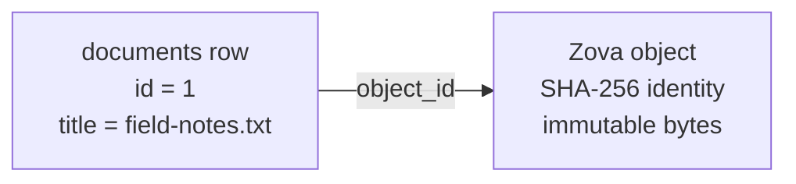

# Build your first database

This walkthrough builds the first slice of a local document library. It stores searchable metadata in SQL and immutable file bytes as a Zova object, then reads them back together.

The example uses Rust because it makes ownership and error handling explicit. The same storage model is available from Python, Go, C, and Zig; their binding chapters show the corresponding syntax.

## What you will build

At the end, `library.zova` contains:

- a `documents` table owned by the application;
- one document row with a title and media type;
- one content-addressed object containing the document bytes; and
- an application-owned reference from the row to that object.



This is the basic Zova pattern: SQL describes the application entity; specialized storage holds the data shape it is designed for.

## Create the database

Create a Rust project and add Zova:

```sh
cargo new zova-library
cd zova-library
cargo add zova@0.23.0
```

Replace `src/main.rs` with the imports and database creation below:

```rust
use std::convert::TryFrom;
use zova::{Database, ObjectId, Step};

fn main() -> Result<(), zova::Error> {
    let mut db = Database::create("library.zova")?;

    // The rest of the walkthrough goes here.

    Ok(())
}
```

`Database::create` expects a new `.zova` destination. It initializes SQLite, Zova's format metadata, and the private schemas used by specialized storage. A renamed `.sqlite` file is not equivalent; use the [SQLite migration workflow](../guides/sqlite-migration.md) for an existing database.

## Create the application schema

Add a table for document metadata:

```rust
db.exec(
    "create table documents(\
       id integer primary key,\
       title text not null,\
       media_type text not null,\
       object_id blob not null,\
       created_at text not null default current_timestamp\
     )",
)?;
```

The table belongs entirely to the application. Zova will not reinterpret the title, add indexes, or enforce a relationship between `object_id` and its private object tables. That separation lets ordinary SQLite tools understand your application schema without requiring them to understand every Zova feature.

Use SQL constraints for application rules. If titles must be unique or a document belongs to a user, model those requirements here exactly as you would in SQLite.

## Store the file bytes

Objects are immutable byte sequences identified by the SHA-256 hash of their complete contents:

```rust
let bytes = b"Zova keeps metadata relational and bytes content-addressed.";
let object_id = db.put_object(bytes)?;
```

Putting identical bytes again returns the same object ID. Internally, Zova chunks object data and deduplicates chunks within the active object store, but callers work with the identity of the complete object.

The ID says what the bytes are, not what they mean. Filename, media type, ownership, and lifecycle remain in the SQL row.

## Connect metadata to bytes

Insert the metadata and bind the object ID as a blob:

```rust
let mut insert = db.prepare(
    "insert into documents(title, media_type, object_id) \
     values (?1, ?2, ?3)",
)?;
insert.bind_text(1, "field-notes.txt")?;
insert.bind_text(2, "text/plain")?;
insert.bind_blob(3, object_id.as_ref())?;
assert_eq!(insert.step()?, Step::Done);
drop(insert);

let document_id = db.last_insert_rowid()?;
println!("stored document {document_id}");
```

Prepared statements keep values separate from SQL text and are the normal interface for user-controlled input. `Step::Done` means the statement completed without producing a row. `last_insert_rowid` returns the SQLite row ID generated on this connection.

:::note[Explicit lifecycle]
Deleting the SQL row does not automatically delete the object, and deleting the object does not rewrite the SQL row. Decide whether objects can be shared, retained, or garbage-collected as part of your application model.
:::

## Read the document back

Query the application row first, reconstruct the typed object ID, and then ask Zova for the bytes:

```rust
let mut query = db.prepare(
    "select title, media_type, object_id \
     from documents where id = ?1",
)?;
query.bind_i64(1, document_id)?;

assert_eq!(query.step()?, Step::Row);
let title = query.column_text(0)?.unwrap().to_owned();
let media_type = query.column_text(1)?.unwrap().to_owned();
let stored_id = ObjectId::try_from(
    query.column_blob(2)?.unwrap().as_slice(),
)?;
drop(query);

let stored_bytes = db.get_object(stored_id)?;
assert_eq!(stored_bytes, bytes);
println!("{title} ({media_type}): {} bytes", stored_bytes.len());
```

The query returns metadata and a reference. The object API resolves that reference and verifies the content-addressed data before returning it.

For a large object, use `read_object_range` when only part of the content is needed, or `ObjectWriter` when input arrives incrementally. The complete object does not need to be assembled in application memory before writing.

## Inspect the result

Run the program, then inspect the database with the CLI:

```sh
cargo run
zova info library.zova
zova tables library.zova
zova objects library.zova
zova check --deep library.zova
```

The inspection commands are bounded: they report identities and metadata without dumping object bytes or arbitrary application rows. `check --deep` validates both the database structure and specialized storage.

## Extend the same model

The document row is now the relational anchor for other capabilities:

- Add a `vector_id` column and store an embedding in a named vector collection. Vector search returns IDs that join back to `documents`.
- Add a `graph_node_id` column and create edges such as `belongs_to`, `derived_from`, or `mentions`.
- Use transactions and savepoints when multiple related mutations must succeed or roll back together under the supported operation policy.
- Keep everything in `library.zova` until there is a concrete operational reason to use an optional bound store.

## What to read next

Continue with [Records](../core/records.md) to understand SQL ownership and transactions, then [Objects](../core/objects.md) for streaming, range reads, deduplication, and deletion behavior. When you are ready to add retrieval, read [Vectors](../core/vectors.md) and the [vector search guide](../guides/vector-search.md).
